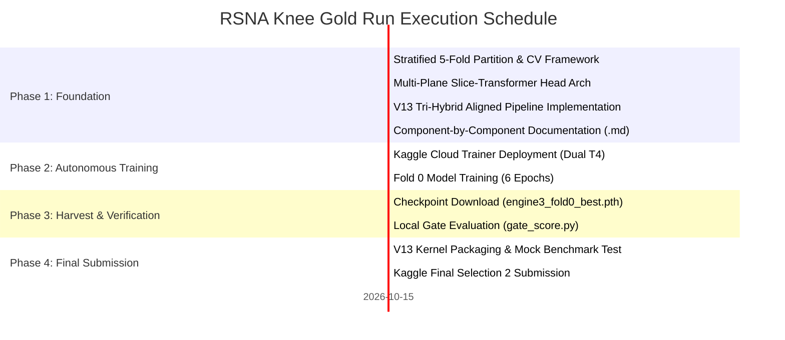

# Master Execution Roadmap: RSNA Knee Gold Run (Target 0.963+)

## 1. Executive Summary
- **Current Position**: Personal Best **0.956** (Rank #1,070, tied with 927 teams up to #274).
- **Gold Tier Target**: **0.963 - 0.967** (Top 15 / Rank #1).
- **Efficiency Target**: Total test-set inference runtime $T \le 450$s to claim the **$18,000 Efficiency Prize** ($T \le 500$s limit).

---

## 2. Milestone Execution Phases

---

## 3. Active Phase Checkpoints

### Milestone 1: Cross-Validation & Architecture [COMPLETED]
- [x] Pure NumPy/Pandas 5-fold Stratified Group-KFold partition generated (`data/train_folds.parquet`).
- [x] Zero-leakage verification suite (`validation/test_cv_framework.py`) passed 100%.
- [x] Multi-Plane Slice-Transformer Head (`training/engine3_slice_transformer/model_multiplane.py`) verified with tensor shape unit tests.
- [x] High-speed percentile rank fusion kernel (`submissions/v13_tri_hybrid_aligned/submission.py`) benchmarked: 100 studies in 0.0023s.

### Milestone 2: Cloud Model Training [IN PROGRESS]
- [x] Standalone trainer (`train_script.py`) created with dynamic mount discovery.
- [x] T4 hardware guardrails applied: gradient checkpointing, native FP16 with GradScaler, `batch_size=2`, `accum_steps=2`.
- [x] Pushed to Kaggle cloud kernel: `cyruspinto/rsna-knee-multiplane-engine3-train`.
- [ ] Active training completion (6 epochs $\approx 80$ minutes).
- [ ] Checkpoint artifact extraction: `/kaggle/working/engine3_multiplane_fold0_best.pth`.

### Milestone 3: Local Gate & Final V13 Submission [PENDING TRAINING]
- [ ] Run `tools/gate_score.py` to evaluate fold 0 out-of-fold predictions against ground truth.
- [ ] Implement ADR-013 Column-Wise Specialist Rank Routing in `submissions/v13_tri_hybrid_aligned/`:
  - 4 Focal Columns (`ACL`, `MCL`, `Medial Meniscus`, `Lateral Meniscus`): 75% weighted to CoAtNet-384 Raptor & Multi-Plane Slice-Transformer.
  - 8 Systemic Columns (`Medial OA`, `Lateral OA`, `PF OA`, `Effusion`, `Synovitis`, `Baker's`, `Contusion`, `Fracture`): 75% weighted to multi-scale ConvNeXt-S6 R7.
- [ ] Pack weights into Kaggle dataset `cyruspinto/rsna-knee-engine3-multiplane-weights`.
- [ ] Verify total test inference latency strictly $\le 450$s ($18,000 Efficiency Prize compliant).
- [ ] Submit to Kaggle leaderboard as Final Selection 2.

### Milestone 4: Next-Gen Retraining with Bayesian Pseudo-Labels (Post-V13)
- [ ] Generate out-of-fold predictions $\hat{\mathbf{Y}}_{\text{vis}}$ across all 4,349 unannotated studies.
- [ ] Compute Bayesian harmonized pseudo-labels $\mathbf{Y}_{\text{harmonized}}$ with conditioned Synovitis priors ($\Pr(\text{Synovitis} \mid \text{Effusion}, \text{Baker's})$).
- [ ] Train second-generation student models incorporating 3D patient-coordinate laterality rectification and anatomical mirroring.
