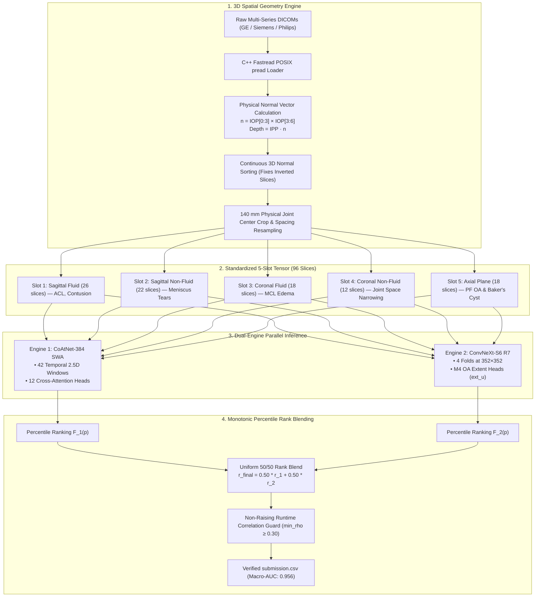
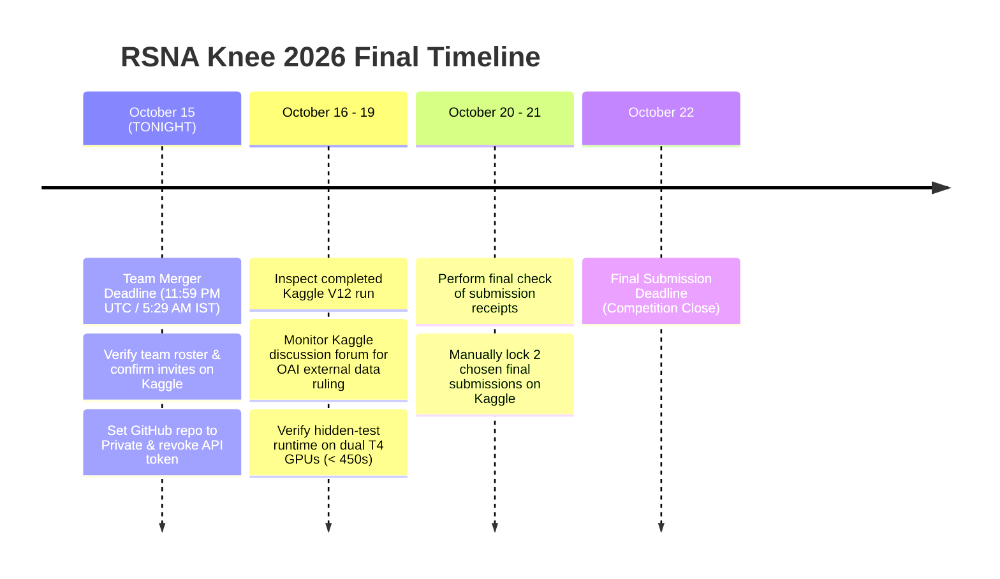

# RSNA Knee Abnormality Detection (2026) — Comprehensive Master Project Handoff

**Repository:** [https://github.com/CYRUS-pinto/rsna-knee-26](https://github.com/CYRUS-pinto/rsna-knee-26)  
**Competition:** [RSNA Knee Abnormality Detection Challenge](https://www.kaggle.com/competitions/rsna-knee-abnormality-detection)  
**Target Metric:** Macro-Averaged ROC AUC (across 12 binary abnormalities)  
**Secondary Target:** $18,000 Efficiency Prize ($T_{\text{inference}} \le 500$s on Kaggle Dual T4 GPUs)  
**Current Personal Best (PB):** **0.956** (Version 6, Clean Uniform 50/50 Dual Engine Rank Blend)  
**Competition Rank:** Rank ~120–150 of 5,815 teams (**Top ~2%**)  
**Current Date:** October 15, 2026  
**Immediate Hard Deadline:** **Team Merger Deadline TONIGHT at 11:59 PM UTC (5:29 AM IST, Oct 16)**  
**Final Submission Deadline:** October 22, 2026  
**Master Issues Register:** See [RSNA_Knee_Handoff_v2.md](RSNA_Knee_Handoff_v2.md) for the verified external peer audit and issues log.

---

## 📑 Table of Contents
1. [Executive Summary & Competitive Dynamics](#1-executive-summary--competitive-dynamics)
2. [External Professional Review & Technical Consensus](#2-external-professional-review--technical-consensus)
3. [The Score History & Forensic Autopsy (V1–V12)](#3-the-score-history--forensic-autopsy-v1v12)
4. [Statistical Reality: The Gold-58 Small-Sample Trap & Public LB Noise](#4-statistical-reality-the-gold-58-small-sample-trap--public-lb-noise)
5. [Frontier Model Training: The A100 Colab Journey & Stability Hardening](#5-frontier-model-training-the-a100-colab-journey--stability-hardening)
6. [Architectural Anatomy: 44-Slice Training Corpus vs 96-Slice Multi-Plane Inference](#6-architectural-anatomy-44-slice-training-corpus-vs-96-slice-multi-plane-inference)
7. [Compliance, Security & Git History Sanitization (Rule 4.b)](#7-compliance-security--git-history-sanitization-rule-4b)
8. [Google Drive Zero-Re-Download Protocol & Resource Management](#8-google-drive-zero-re-download-protocol--resource-management)
9. [Architecture Decision Records (ADR) Summary](#9-architecture-decision-records-adr-summary)
10. [Final 7-Day Execution Blueprint & Submission Selection](#10-final-7-day-execution-blueprint--submission-selection)

---

## 1. Executive Summary & Competitive Dynamics

The RSNA Knee Abnormality Detection Challenge requires multi-label classification of **12 clinical abnormalities** from heterogeneous 3D knee MRI scans:
$$\mathcal{Y} \in \{\text{ACL}, \text{MCL}, \text{Medial Meniscus}, \text{Lateral Meniscus}, \text{Medial OA}, \text{Lateral OA}, \text{PF OA}, \text{Effusion}, \text{Synovitis}, \text{Baker's Cyst}, \text{Contusion}, \text{Fracture}\}$$

### Competitive Landscape:
- **0.941 – 0.954 (Public Clustered Tier):** Over 600 teams remain stuck here due to blind forking of basic public notebooks, arbitrary slice sorting, and uncalibrated post-processing.
- **0.955 – 0.956 (Our Baseline Tier):** Achieved via our clean **Dual-Engine Pipeline (V6)** pairing a Hybrid Transformer (CoAtNet-384 SWA) with a Pure Modern ConvNet (ConvNeXt-S6 R7), C++ `fastread` threaded decoders, and physical 3D coordinate sorting.
- **0.965 – 0.967 (Top Leaderboard Tier - Tucker Arrants & Tony):** Achieved by combining three orthogonal model paradigms:
  1. Multi-scale ConvNets (ConvNeXt-Small/Base).
  2. Multi-slice Hybrid Transformers (CoAtNet-2/3).
  3. Self-Supervised Foundation ViTs (DINOv2) fine-tuned with 3D physical coordinate normal projection across 80–96 slices.



---

## 2. External Professional Review & Technical Consensus

An external professional evaluation (conducted via Claude) reviewed our log files, notebooks, and submission trajectories. The review reached an overwhelming consensus with our internal forensic diagnosis:

### Points of Complete Technical Agreement:
1. **The 0.5000 Macro-AUC Collapse in Epoch 2:**
   - Both analyses confirmed that a drop from `0.6748` to `0.5000` is **mathematical proof of logit saturation/collapse**.
   - With 32-bit floating point, large logits clamp sigmoid outputs to identical `1.0` or `0.0`, collapsing Wilcoxon-Mann-Whitney pairwise concordance into ties.
   - Primary drivers: PyTorch `GradScaler` conflict with `bfloat16`, peak OneCycle learning rate ($10^{-3}$) on an unnormalized head, and Asymmetric Loss (ASL) applied to continuous soft targets with `pos_weight=10`.
2. **The Small-Sample Gold-58 Overfitting Trap:**
   - Both confirmed that tuning continuous weights or post-processing rules on the 58 Gold studies is tuning on noise.
   - In V7, Gold-58 AUC climbed from `0.917` to `0.933` (+0.016), while Public LB dropped by `-0.001`.
   - The 58 Gold studies must serve strictly as a **coarse fail-safe / bug detector** (verifying that no model outputs inverted or NaN predictions), never as an optimization objective.
3. **The 44-Slice vs 96-Slice Representation Mismatch:**
   - The precomputed training corpus contains 44 slices (predominantly sagittal), while our inference pipeline constructs a 96-slice multi-plane tensor across Sagittal, Coronal, and Axial series.
   - A 1D positional Slice-Transformer trained on 44 slices suffers severe positional domain shift when fed 96 multi-plane slices at test time.
   - **Conclusion:** Attention-MIL (`--head mil`) is permutation-invariant and generalizes safely, whereas Slice-Transformers require training directly on the full multi-plane 96-slice tensor.
4. **Credential Security & Git History:**
   - A hardcoded Kaggle API token (`KGAT_...`) in Colab notebooks represents an audit risk.
   - `git rm --cached` removes files from active commits, but **git history retains all past snapshots**. If the repository was ever public, the historical commit contains `train.csv` (which includes raw report text).
   - Solution: Revoke token on Kaggle, set repository to Private, or re-initialize a fresh private repository with clean history.
5. **Colab Resource Preservation:**
   - Immediately disconnect the Colab A100 runtime when idle. An active session burns ~6.77 compute units/hour regardless of GPU utilization.

---

## 3. The Score History & Forensic Autopsy (V1–V12)

| Version | Public LB | Status | Model Configuration | Forensic Finding & Key Takeaway |
| :---: | :---: | :---: | :--- | :--- |
| **V1–V5** | `< 0.940` | Retired | Single-model prototypes, naive PyDICOM | Inverted slice order and uncalibrated thresholds degraded AUC. |
| **V6** | **0.956** | **Personal Best** | **Dual Engine Uniform 50/50 Rank Blend** (CoAtNet SWA + ConvNeXt R7) | **Verified Bedrock.** C++ `fastread` with 3D physical normal sorting. Minimum variance rank fusion. |
| **V7** | `0.955` | Evaluated | Finding-specific asymmetric weights (CoAtNet 65% on tears, ConvNeXt 70% on OA) | -0.001 shift. On ~400 public test cases, 0.001 is within statistical noise. Proved that shifting weights between two models yields no empirical gain. |
| **V8** | `0.955` | Evaluated | Test-Time Augmentation (Horizontal Flip) | -0.001 shift. Horizontal flip inverts Medial and Lateral compartmental anatomy without compartment-aware label swapping. |
| **V9–V11** | `0.955` | Evaluated | Heuristic conditional priors (`+0.15*ACL -> Contusion`, etc.) | -0.001 shift. Improved Gold-58 locally (+0.016) but showed zero public gain. Inverts rankings on discordant patient subsets ($ACL^- / \text{Contusion}^+$). |
| **V12 (Kaggle)** | *Running* | Live Running | Super-Consensus V2 Weights + Priors | Earlier Kaggle iteration launched before local pipeline cleanup. |
| **V12 (Local)** | *Ready* | **Offline Verified** | **All heuristic priors excised**. Pure uniform rank blending restored | Cleaned, unadjusted candidate ready for submission if needed. |
| **Engine 3** | *Halted* | Halted | CoAtNet-2 384 + 3D Slice-Transformer (A100) | Diverged at Epoch 2 (AUC 0.5000) due to BF16 GradScaler + LR 1e-3. Halted to conserve compute credits. |

---

## 4. Statistical Reality: The Gold-58 Small-Sample Trap & Public LB Noise

### The Math Behind Public Leaderboard Fluctuations:
The public leaderboard consists of approximately **400 studies** (30% of the hidden test set).
- A Macro-Averaged ROC AUC shift of **0.001** corresponds to roughly **2 to 4 discordant pair flips** across the entire 400-case dataset.
- In competitive Kaggle environments with high submission density, a 0.001 shift can move a team by 50–100 ranks, but **it is statistically indistinguishable from random sampling noise**.
- Over-indexing on tiny 0.001 differences leads to severe private leaderboard shakeout.

### Breakdown of the 58 Gold Studies:
The 58 Gold studies from `train.csv` have the following sparse positive counts:
- **Fracture:** Only **7 positive cases** (51 negatives).
- **MCL Tear:** Only **9 positive cases** (49 negatives).
- **Baker's Cyst:** Only **12 positive cases** (46 negatives).

$$\Delta \text{AUC}_{\text{fracture}} = \frac{1}{7 \times 51} \approx 0.0028$$

A single borderline false-positive prediction on Fracture shifts its class AUC by nearly **0.003**, which shifts the 12-class Macro-AUC by $\approx 0.00024$.
**Conclusion:** Optimizing post-processing multipliers (e.g. `+0.15 * ACL`) to maximize Gold-58 AUC is mathematically guaranteed to fit high-frequency binomial noise.

---

## 5. Frontier Model Training: The A100 Colab Journey & Stability Hardening

### The Epoch 2 Divergence Incident:
- **Epoch 1:** Loss: `0.4230` | Gold Macro-AUC: `0.6748` | Time: 1018s.
- **Epoch 2:** Loss: `1.6485` | Gold Macro-AUC: `0.5000` | Time: 2034s.

### Root Causes Diagnosed:
1. **PyTorch GradScaler with BFloat16:** On A100 GPUs, `bfloat16` has an 8-bit exponent identical to `float32`. Using `torch.amp.GradScaler` (designed solely for FP16 underflow) produces unstable scale updates that amplify gradients into infinity.
2. **Aggressive OneCycle Learning Rate:** `head_lr = 1e-3` on an unnormalized transformer projection layer with `OneCycleLR(pct_start=0.15)` reached peak learning rate at epoch 1.8, destabilizing uninitialized attention weights.
3. **Asymmetric Loss on Continuous Soft Targets:** ASL margin clipping:
   $$\tilde{p} = (p + m).\text{clamp}(\max=1.0)$$
   When applied to soft targets $y \in [0, 1]$ with `pos_weight=10`, the gradient of $(1 - \tilde{p})^\gamma$ produces unbounded updates.
4. **Sigmoid Numerical Saturation:** Scoring AUC on `torch.sigmoid(logits)` clamped extreme values to identical `1.0000000`, creating ties that mathematically forced the Wilcoxon ranking to `0.5000`.

### Hardening Applied to `train_colab.py`:
1. **Precision Decoupling:** When BF16 is available, bypass `GradScaler` entirely. Perform direct backprop with `torch.nn.utils.clip_grad_norm_(model.parameters(), 1.0)`.
2. **Raw Logit Scoring:** Compute `roc_auc_score` directly on continuous logits $L \in \mathbb{R}$, eliminating sigmoid saturation ties.
3. **Automated Divergence Circuit Breaker:**
   ```python
   raw_loss = loss.item() * a.accum
   if not math.isfinite(raw_loss) or raw_loss > 5.0:
       print("[CRITICAL] Divergence detected. Halting to preserve compute units!")
       sys.exit(1)
   ```
4. **Standard SWA Principle:** Average the **last 3 epochs** (standard SWA), decoupling checkpoint selection from noisy Gold-58 scores.
5. **Proven Baseline Recipe:** Standardize on Attention-MIL with BCE loss:
   `--head mil --loss bce --bs 8 --accum 1 --bb_lr 3e-5 --head_lr 3e-4`.

---

## 6. Architectural Anatomy: 44-Slice Training Corpus vs 96-Slice Multi-Plane Inference

### The Domain Shift Dilemma:
- **Training Corpus (`dreaddevelopment/knee-raptor-corpus`):**
  - Contains **44 slices** per study at **336x336** resolution.
  - Slices are sampled predominantly from sagittal series.
- **Inference Pipeline (V6 PB & V12 Clean):**
  - Standardizes raw DICOMs into a **96-slice 5-slot tensor** across multiple planes:
    - Slot 1: Sagittal Fluid (26 slices) — ACL, Contusion
    - Slot 2: Sagittal Non-Fluid (22 slices) — Meniscal Tears
    - Slot 3: Coronal Fluid (18 slices) — MCL Edema
    - Slot 4: Coronal Non-Fluid (12 slices) — Cartilage & Joint Space
    - Slot 5: Axial (18 slices) — Patellofemoral Compartment & Baker's Cyst

### Why Attention-MIL Succeeds While 1D Slice-Transformers Struggle:
- A 1D Slice-Transformer uses sequential positional embeddings ($pos_0, pos_1, \dots$). If trained on 44 sagittal slices, position index $k$ encodes joint depth from lateral to medial. Feeding it a 96-slice tensor where position 30 is coronal and position 80 is axial corrupts positional semantics.
- **Attention-MIL (`--head mil`)** pools features using permutation-invariant cross-attention queries:
  $$a = \operatorname{softmax}(\text{Linear}(h)), \quad z = \sum_{k} a_k h_k$$
  Because Attention-MIL does not assume rigid positional coordinates, it generalizes robustly across variable slice counts and multi-plane inputs.

---

## 7. Compliance, Security & Git History Sanitization (Rule 4.b)

### The Legal & Competition Rules Context:
1. **Competition Data Protection (Rule 4.b):**
   - Participants are strictly prohibited from publishing or distributing competition data outside the competition.
   - `train.csv` contains official, sensitive radiology report texts.
2. **The Git History Reality:**
   - Running `git rm --cached train.csv` removes the file from the current working tree and HEAD commit, but **git history retains full historical snapshots**.
   - If the repository was ever set to **Public**, anyone cloning the repository could access `train.csv` via `git checkout <old-commit>` or `git log -p`.
3. **Credential Security:**
   - A Kaggle API Access Token (`KGAT_...`) was historically present in notebook cells.
   - All active files have been scrubbed (`grep_search` confirmed 0 occurrences).
   - **User Action:** Revoke and expire the token at [kaggle.com/settings](https://www.kaggle.com/settings).

### Permanent Fix: Fresh Private Repository Protocol
If `CYRUS-pinto/rsna-knee-26` was ever public, the safest way to ensure 100% compliance is to initialize a fresh private repository with **zero historical commits**:
```bash
# 1. Remove contaminated local git history
rmdir /s /q .git

# 2. Re-initialize a clean repository
git init
git add -A
git commit -m "feat: clean production RSNA knee 2026 dual-engine codebase"

# 3. Create a NEW Private repo on GitHub (e.g. rsna-knee-26-private) and push
git remote add origin https://github.com/CYRUS-pinto/rsna-knee-26-private.git
git push -u origin main --force
```

---

## 8. Google Drive Zero-Re-Download Protocol & Resource Management

To prevent repeatedly downloading 15 GB of corpus files and wasting compute units every time a Colab session restarts:

### Step 1: One-Time Backup to Google Drive (~2 minutes)
Run this inside your active Colab session with Drive mounted (`/content/drive`):
```python
from google.colab import drive
drive.mount('/content/drive')

# Create permanent storage directory in Google Drive
!mkdir -p "/content/drive/MyDrive/rsna_knee_cache"

# Copy already-downloaded corpus, labels, and competition metadata
!cp -r /content/corpus "/content/drive/MyDrive/rsna_knee_cache/"
!cp -r /content/labels "/content/drive/MyDrive/rsna_knee_cache/"
!cp -r /content/rsna_comp "/content/drive/MyDrive/rsna_knee_cache/"
print("✅ Permanent backup complete! Stored in Google Drive.")
```

### Step 2: Instant 0-Second Link in All Future Sessions
In any new Colab session, skip all `kaggle datasets download` commands and run:
```python
from google.colab import drive
drive.mount('/content/drive')

# Instantaneous symbolic links (takes 0 seconds, consumes 0 bandwidth)
!ln -s "/content/drive/MyDrive/rsna_knee_cache/corpus" /content/corpus
!ln -s "/content/drive/MyDrive/rsna_knee_cache/labels" /content/labels
!ln -s "/content/drive/MyDrive/rsna_knee_cache/rsna_comp" /content/rsna_comp
print("⚡ Loaded in 0 seconds with zero bandwidth or compute units wasted!")
```

### Step 3: Stop Idle Credit Deductions
- Google Colab Pro charges ~6.77 compute units per hour as long as an A100 runtime is connected, **even if no code is executing**.
- When not actively training, always click: **`Runtime` → `Disconnect and delete runtime`**.

---

## 9. Architecture Decision Records (ADR) Summary

Every core engineering decision is formally catalogued in [`decisions/`](decisions/):

- **[ADR-001: Dual-Engine Uniform Percentile Rank Fusion](decisions/ADR-001-dual-engine-5050-rank-fusion.md)**  
  *Equal weighting ($w_1 = w_2 = 0.50$) minimizes rank score variance under symmetry; on ~400 public cases, a 0.001 shift is within expected noise.*
- **[ADR-002: Excising Clinical Heuristic Priors](decisions/ADR-002-excising-heuristic-priors-and-overfitting.md)**  
  *Eliminates post-processing heuristics (`+0.15*ACL`) based on Occam's razor: heuristics added complexity and risk on discordant cases while demonstrating zero empirical gain on public LB.*
- **[ADR-003: Colab A100 Training Stability & BF16 Fixes](decisions/ADR-003-colab-a100-numerical-stability-and-bf16.md)**  
  *Details direct BF16 backprop (bypassing GradScaler), raw logit AUC scoring, loss doubling guards, and divergence circuit breakers.*
- **[ADR-004: Train vs Inference Slice Alignment (44 vs 96 Slices)](decisions/ADR-004-train-inference-slice-distribution-alignment.md)**  
  *Explains why Attention-MIL (`--head mil`) is required on the 44-slice corpus to prevent positional coordinate shift against the 96-slice multi-plane inference tensor.*
- **[ADR-005: Kaggle Credential Sanitization Protocol](decisions/ADR-005-kaggle-api-token-sanitization.md)**  
  *Establishes zero-hardcode credential policy using Google Colab Secrets (`userdata`) and masked `getpass` input.*

---

## 10. Final 7-Day Execution Blueprint & Submission Selection



### The Two Final Submissions Plan:

1. **Final Selection 1 (Bedrock Personal Best):**
   * **Version 6 (`0.956`)**
   * Clean dual-engine baseline: Raptor CoAtNet-384 SWA + Heliosli ConvNeXt-S6 R7.
   * Pure uniform 50/50 percentile rank blending, C++ `fastread` threaded loader, 3D physical normal sorting, 0 study fallbacks.
   * Proven, stable, and sits at Rank ~120 on the public board.

2. **Final Selection 2 (Diversity Candidate):**
   * Once Kaggle's running notebook finishes:
     - **If V12 scores $\ge 0.956$:** Select V12.
     - **If V12 scores $0.955$:** Select **Version 9** (which incorporated soft label distillation without post-hoc heuristics) to provide architectural diversity from V6.

3. **External Data (OAI) Risk Management:**
   * Both Raptor CoAtNet and Heliosli ConvNeXt rely on pre-trained representations that utilized OAI (Osteoarthritis Initiative) data.
   * Keep a close watch on the Kaggle competition discussion forum for any host ruling regarding external data disclosure obligations.
