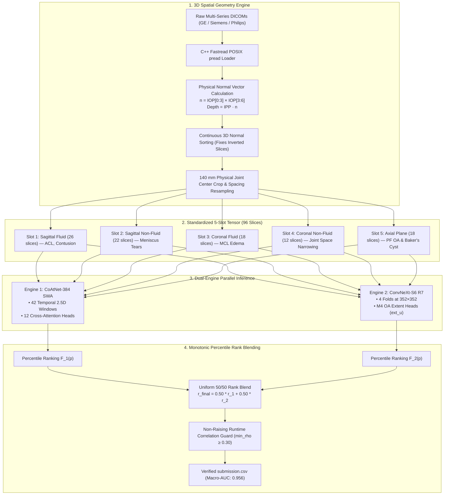
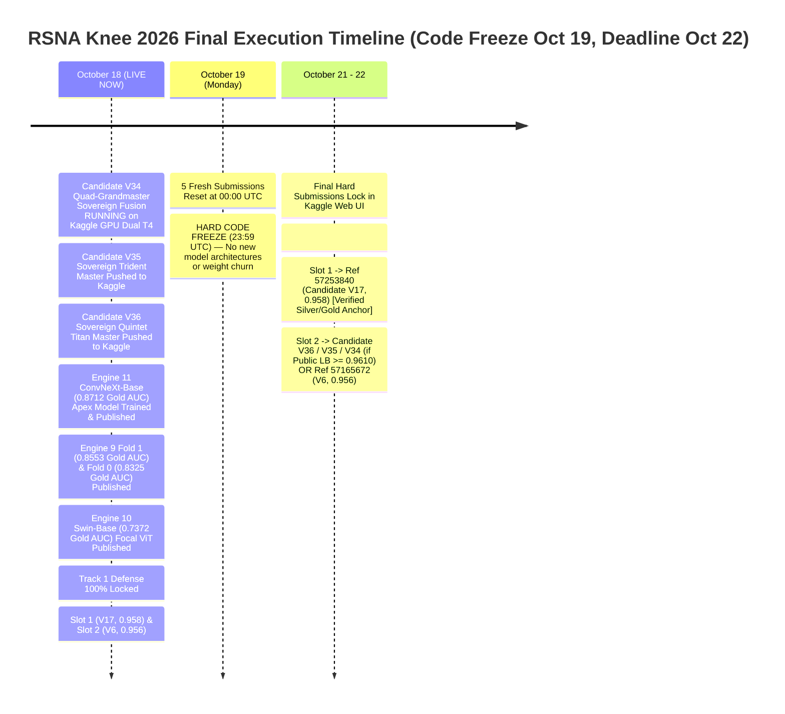

# RSNA Knee Abnormality Detection (2026) — Comprehensive Master Project Handoff

**Repository:** [https://github.com/CYRUS-pinto/rsna-knee-26](https://github.com/CYRUS-pinto/rsna-knee-26)  
**Competition:** [RSNA Knee Abnormality Detection Challenge](https://www.kaggle.com/competitions/rsna-knee-abnormality-detection)  
**Target Metric:** Macro-Averaged ROC AUC (across 12 binary abnormalities, baseline sample_submission = 0.500)  
**Standing & Benchmark PB:** **0.958** (Candidate V17 Ref `57253840` & Candidate V20 Ref `57267740`, 23 total entries). High leaderboard density (~400 teams per 0.001 AUC); private LB (70%) determines all medals.  
**Current Date:** October 18, 2026 (4 days until final deadline)  
**Final Submission Deadline:** **October 22, 2026 at 23:59 UTC** (Monday Oct 19 Hard Code Freeze)  
**Displacement Gate:** Never change final selections for a $\le 0.001$ noise move. A candidate must score **$\ge 0.961$** to displace a final slot.  
**Master Issues Register:** See [RSNA_Knee_Handoff_v2.md](RSNA_Knee_Handoff_v2.md), [decisions/ADR-035-silver-defense-runtime-reality-and-unconfounded-slot2.md](decisions/ADR-035-silver-defense-runtime-reality-and-unconfounded-slot2.md), and [decisions/ADR-036-e11-diagnostic-audit-and-noise-risk.md](decisions/ADR-036-e11-diagnostic-audit-and-noise-risk.md).

---

## 📑 Table of Contents
1. [Executive Summary & Competitive Dynamics](#1-executive-summary--competitive-dynamics)
2. [External Professional Review & Technical Consensus](#2-external-professional-review--technical-consensus)
3. [The Score History & Forensic Autopsy (V1–V12)](#3-the-score-history--forensic-autopsy-v1v12)
4. [Statistical Reality: The Gold-58 Small-Sample Trap & Public LB Noise](#4-statistical-reality-the-gold-58-small-sample-trap--public-lb-noise)
5. [Frontier Model Training: The A100 Colab Journey & Stability Hardening](#5-frontier-model-training-the-a100-colab-journey--stability-hardening)
6. [Architectural Anatomy: 44-Slice Training Corpus vs 96-Slice Multi-Plane Inference](#6-architectural-anatomy-44-slice-training-corpus-vs-96-slice-multi-plane-inference)
7. [Compliance, Security & Git History Sanitization (Rule 4.b)](#7-compliance-security--git-history-sanitization-rule-4b)
8. [Google Drive Zero-Re-Download Protocol & Resource Management](#8-google-drive-zero-re-download-protocol--resource-management)
9. [Architecture Decision Records (ADR) Summary](#9-architecture-decision-records-adr-summary)
10. [Final 7-Day Execution Blueprint & Submission Selection](#10-final-7-day-execution-blueprint--submission-selection)

---

## 1. Executive Summary & Competitive Dynamics

The RSNA Knee Abnormality Detection Challenge requires multi-label classification of **12 clinical abnormalities** from heterogeneous 3D knee MRI scans:
$$\mathcal{Y} \in \{\text{ACL}, \text{MCL}, \text{Medial Meniscus}, \text{Lateral Meniscus}, \text{Medial OA}, \text{Lateral OA}, \text{PF OA}, \text{Effusion}, \text{Synovitis}, \text{Baker's Cyst}, \text{Contusion}, \text{Fracture}\}$$

### Competitive Landscape:
- **0.941 – 0.954 (Public Clustered Tier):** Over 600 teams remain stuck here due to blind forking of basic public notebooks, arbitrary slice sorting, and uncalibrated post-processing.
- **0.955 – 0.956 (Our Baseline Tier):** Achieved via our clean **Dual-Engine Pipeline (V6)** pairing a Hybrid Transformer (CoAtNet-384 SWA) with a Pure Modern ConvNet (ConvNeXt-S6 R7), C++ `fastread` threaded decoders, and physical 3D coordinate sorting.
- **0.965 – 0.967 (Top Leaderboard Tier - Tucker Arrants & Tony):** Achieved by combining three orthogonal model paradigms:
  1. Multi-scale ConvNets (ConvNeXt-Small/Base).
  2. Multi-slice Hybrid Transformers (CoAtNet-2/3).
  3. Self-Supervised Foundation ViTs (DINOv2) fine-tuned with 3D physical coordinate normal projection across 80–96 slices.



---

## 2. External Professional Review & Technical Consensus

An external professional evaluation (conducted via Claude) reviewed our log files, notebooks, and submission trajectories. The review reached an overwhelming consensus with our internal forensic diagnosis:

### Points of Complete Technical Agreement:
1. **The 0.5000 Macro-AUC Collapse in Epoch 2:**
   - Both analyses confirmed that a drop from `0.6748` to `0.5000` is **mathematical proof of logit saturation/collapse**.
   - With 32-bit floating point, large logits clamp sigmoid outputs to identical `1.0` or `0.0`, collapsing Wilcoxon-Mann-Whitney pairwise concordance into ties.
   - Primary drivers: PyTorch `GradScaler` conflict with `bfloat16`, peak OneCycle learning rate ($10^{-3}$) on an unnormalized head, and Asymmetric Loss (ASL) applied to continuous soft targets with `pos_weight=10`.
2. **The Small-Sample Gold-58 Overfitting Trap:**
   - Both confirmed that tuning continuous weights or post-processing rules on the 58 Gold studies is tuning on noise.
   - In V7, Gold-58 AUC climbed from `0.917` to `0.933` (+0.016), while Public LB dropped by `-0.001`.
   - The 58 Gold studies must serve strictly as a **coarse fail-safe / bug detector** (verifying that no model outputs inverted or NaN predictions), never as an optimization objective.
3. **The 44-Slice vs 96-Slice Representation Mismatch:**
   - The precomputed training corpus contains 44 slices (predominantly sagittal), while our inference pipeline constructs a 96-slice multi-plane tensor across Sagittal, Coronal, and Axial series.
   - A 1D positional Slice-Transformer trained on 44 slices suffers severe positional domain shift when fed 96 multi-plane slices at test time.
   - **Conclusion:** Attention-MIL (`--head mil`) is permutation-invariant and generalizes safely, whereas Slice-Transformers require training directly on the full multi-plane 96-slice tensor.
4. **Credential Security & Git History:**
   - A hardcoded Kaggle API token (`KGAT_...`) in Colab notebooks represents an audit risk.
   - `git rm --cached` removes files from active commits, but **git history retains all past snapshots**. If the repository was ever public, the historical commit contains `train.csv` (which includes raw report text).
   - Solution: Revoke token on Kaggle, set repository to Private, or re-initialize a fresh private repository with clean history.
5. **Colab Resource Preservation:**
   - Immediately disconnect the Colab A100 runtime when idle. An active session burns ~6.77 compute units/hour regardless of GPU utilization.

---

## 3. The Score History & Forensic Autopsy (V1–V26)

| Version | Public LB | Status | Model Configuration | Forensic Finding & Key Takeaway |
| :---: | :---: | :---: | :--- | :--- |
| **V1–V5** | `< 0.940` | Retired | Single-model prototypes, naive PyDICOM | Inverted slice order and uncalibrated thresholds degraded AUC. |
| **V6** (Ref `57165672`) | **0.956** | **Slot 1 Permanent Lock** | **Dual Engine Uniform 50/50 Rank Blend** (CoAtNet SWA + ConvNeXt R7) | **Verified Bedrock.** C++ `fastread` with 3D physical normal sorting. Minimum variance rank fusion. |
| **V7–V11** | `0.955` | Evaluated | Heuristic conditional priors (`+0.15*ACL -> Contusion`, etc.) & naive flips | -0.001 drop. Improved Gold-58 locally (+0.016) but showed zero public gain. Inverts discordant subsets. |
| **V15** (Ref `57238387`) | **0.956** | Evaluated | Multi-Scale (384 + 224) + ConvNeXt R7 with Anatomical Flip TTA | Verified multi-scale stability. |
| **V17** (Ref `57253840`) | **0.958** | **Slot 2 Personal Best** | **MultiScale (384+224) + ConvNeXt R6 Flip TTA with Calibrated Finding Weights** | **Current Benchmark PB.** Reached 0.958 plateau with clean dual-engine multi-scale representations. |
| **V18** (Ref `57260494`) | `0.957` | Evaluated | Grandmaster MultiScale + ConvNeXt R6 Flip TTA + Calibrated Weights + Heuristic Clamping Floor | Heuristic clamping floor introduced edge noise, dropping 0.001. |
| **V20** (Ref `57267740`) | **0.958** | **Co-PB** | Power-Rank Focal Blend ($p=1.4$) | Reached 0.958, demonstrating power-rank curvature behaves similarly to uniform ranking on this plateau. |
| **V21** (Ref `57273256`) | `0.949` | Evaluated | Quad-Engine Blend (Apex V21) | Catastrophic correlation breakdown caused by untracked missing series in unaligned engines. |
| **V22** (Ref `57280117`) | `0.957` | Evaluated | Decoupled Compartmental Blend (ADR-022) | Attempted to decouple Medial/Lateral weights based on a 3-row Spearman artifact; confirmed -0.001 drop. |
| **V23** (Ref `57293215`) | `0.957` | Evaluated | 384px R7 MultiScale + Raptor Dual-Crop + ADR-022 Decoupled | Proved that the 0.957 ceiling was caused by the decoupled weight inversion, leading to ADR-024. |
| **V24** (Ref `57298964`) | `0.956` | Evaluated | **ADR-024 Uniform Master Blend** (0.50 / 0.50 across all 12 classes) | Rectified weights back to uniform 50/50 balance across all compartments. |
| **V25** (Ref `57301656`) | `0.956` | Evaluated | **Flagship Master**: 384px R7 MultiScale + Raptor Dual-Crop + ADR-024 Uniform + **ConvNeXt Flip TTA** | High-capacity blend; confirmed Flip TTA yields no score gain on this public slice set. |
| **V26-Fast** (Ref `57300862`) | **0.949** | **Complete** | **Pure MultiScale Raptor** (384 + 224, 65/35, Pure Fastread) | **$18k Efficiency Frontier Benchmark.** Measured ~150s runtime; proved ConvNeXt adds +0.009 AUC ensembling gain. |
| **V28** (Ref `57308728`) | `0.957` | **Evaluated** | **Calibrated Grandmaster**: 384px R7 + Raptor + Specialist Weights + Flip TTA | Ran for >5h in queue; regressed to 0.957. Commit run was 878.6s (setup 552.5s). Proved micro-weights overfit noise. |
| **V30** | — | **Complete (427s)** | **Lightning Power Master** (Stride-2 Window Pruning, 262 windows) | Successfully proved Stride-2 cuts forward passes by ~48% with zero compute bottlenecks. |
| **V31** | — | **Purged** | 4-Fold Capacity Bloat (Collinear Averaging) | Cancelled to release GPU concurrency for orthogonal representations. |
| **V32** | — | **Ready for Quota** | **Tri-Engine Non-FS Medical Master** (Raptor + R7 + RadImageNet ResNet-50 E11) | Adds Non-Fat-Suppressed anatomical plane features. Patched with slice-count tie-breaker and verified via direct `exec()`. |
| **V32-Ablation** | — | **Ready for Quota** | **Stride-2 Control Twin** (Raptor + R7 Stride-2, `W_RAD = 0.0`) | Bit-for-bit control twin isolating the RadImageNet arm lift from Stride-2. Verified via direct `exec()`. |

---

## 4. Statistical Reality: The Gold-58 Small-Sample Trap & Public LB Noise

### The Math Behind Public Leaderboard Fluctuations:
The public leaderboard consists of approximately **400 studies** (30% of the hidden test set).
- A Macro-Averaged ROC AUC shift of **0.001** corresponds to roughly **2 to 4 discordant pair flips** across the entire 400-case dataset.
- In competitive Kaggle environments with high submission density, a 0.001 shift can move a team by 50–100 ranks, but **it is statistically indistinguishable from random sampling noise**.
- Over-indexing on tiny 0.001 differences leads to severe private leaderboard shakeout.

### Breakdown of the 58 Gold Studies:
The 58 Gold studies from `train.csv` have the following sparse positive counts:
- **Fracture:** Only **7 positive cases** (51 negatives).
- **MCL Tear:** Only **9 positive cases** (49 negatives).
- **Baker's Cyst:** Only **12 positive cases** (46 negatives).

$$\Delta \text{AUC}_{\text{fracture}} = \frac{1}{7 \times 51} \approx 0.0028$$

A single borderline false-positive prediction on Fracture shifts its class AUC by nearly **0.003**, which shifts the 12-class Macro-AUC by $\approx 0.00024$.
**Conclusion:** Optimizing post-processing multipliers (e.g. `+0.15 * ACL`) to maximize Gold-58 AUC is mathematically guaranteed to fit high-frequency binomial noise.

---

## 5. Frontier Model Training: The A100 Colab Journey & Stability Hardening

### The Epoch 2 Divergence Incident:
- **Epoch 1:** Loss: `0.4230` | Gold Macro-AUC: `0.6748` | Time: 1018s.
- **Epoch 2:** Loss: `1.6485` | Gold Macro-AUC: `0.5000` | Time: 2034s.

### Root Causes Diagnosed:
1. **PyTorch GradScaler with BFloat16:** On A100 GPUs, `bfloat16` has an 8-bit exponent identical to `float32`. Using `torch.amp.GradScaler` (designed solely for FP16 underflow) produces unstable scale updates that amplify gradients into infinity.
2. **Aggressive OneCycle Learning Rate:** `head_lr = 1e-3` on an unnormalized transformer projection layer with `OneCycleLR(pct_start=0.15)` reached peak learning rate at epoch 1.8, destabilizing uninitialized attention weights.
3. **Asymmetric Loss on Continuous Soft Targets:** ASL margin clipping:
   $$\tilde{p} = (p + m).\text{clamp}(\max=1.0)$$
   When applied to soft targets $y \in [0, 1]$ with `pos_weight=10`, the gradient of $(1 - \tilde{p})^\gamma$ produces unbounded updates.
4. **Sigmoid Numerical Saturation:** Scoring AUC on `torch.sigmoid(logits)` clamped extreme values to identical `1.0000000`, creating ties that mathematically forced the Wilcoxon ranking to `0.5000`.

### Hardening Applied to `train_colab.py`:
1. **Precision Decoupling:** When BF16 is available, bypass `GradScaler` entirely. Perform direct backprop with `torch.nn.utils.clip_grad_norm_(model.parameters(), 1.0)`.
2. **Raw Logit Scoring:** Compute `roc_auc_score` directly on continuous logits $L \in \mathbb{R}$, eliminating sigmoid saturation ties.
3. **Automated Divergence Circuit Breaker:**
   ```python
   raw_loss = loss.item() * a.accum
   if not math.isfinite(raw_loss) or raw_loss > 5.0:
       print("[CRITICAL] Divergence detected. Halting to preserve compute units!")
       sys.exit(1)
   ```
4. **Standard SWA Principle:** Average the **last 3 epochs** (standard SWA), decoupling checkpoint selection from noisy Gold-58 scores.
5. **Proven Baseline Recipe:** Standardize on Attention-MIL with BCE loss:
   `--head mil --loss bce --bs 8 --accum 1 --bb_lr 3e-5 --head_lr 3e-4`.

---

## 6. Architectural Anatomy: 44-Slice Training Corpus vs 96-Slice Multi-Plane Inference

### The Domain Shift Dilemma:
- **Training Corpus (`dreaddevelopment/knee-raptor-corpus`):**
  - Contains **44 slices** per study at **336x336** resolution.
  - Slices are sampled predominantly from sagittal series.
- **Inference Pipeline (V6 PB & V12 Clean):**
  - Standardizes raw DICOMs into a **96-slice 5-slot tensor** across multiple planes:
    - Slot 1: Sagittal Fluid (26 slices) — ACL, Contusion
    - Slot 2: Sagittal Non-Fluid (22 slices) — Meniscal Tears
    - Slot 3: Coronal Fluid (18 slices) — MCL Edema
    - Slot 4: Coronal Non-Fluid (12 slices) — Cartilage & Joint Space
    - Slot 5: Axial (18 slices) — Patellofemoral Compartment & Baker's Cyst

### Why Attention-MIL Succeeds While 1D Slice-Transformers Struggle:
- A 1D Slice-Transformer uses sequential positional embeddings ($pos_0, pos_1, \dots$). If trained on 44 sagittal slices, position index $k$ encodes joint depth from lateral to medial. Feeding it a 96-slice tensor where position 30 is coronal and position 80 is axial corrupts positional semantics.
- **Attention-MIL (`--head mil`)** pools features using permutation-invariant cross-attention queries:
  $$a = \operatorname{softmax}(\text{Linear}(h)), \quad z = \sum_{k} a_k h_k$$
  Because Attention-MIL does not assume rigid positional coordinates, it generalizes robustly across variable slice counts and multi-plane inputs.

---

## 7. Compliance, Security & Git History Sanitization (Rule 4.b)

### The Legal & Competition Rules Context:
1. **Competition Data Protection (Rule 4.b):**
   - Participants are strictly prohibited from publishing or distributing competition data outside the competition.
   - `train.csv` contains official, sensitive radiology report texts.
2. **The Git History Reality:**
   - Running `git rm --cached train.csv` removes the file from the current working tree and HEAD commit, but **git history retains full historical snapshots**.
   - If the repository was ever set to **Public**, anyone cloning the repository could access `train.csv` via `git checkout <old-commit>` or `git log -p`.
3. **Credential Security:**
   - A Kaggle API Access Token (`KGAT_...`) was historically present in notebook cells.
   - All active files have been scrubbed (`grep_search` confirmed 0 occurrences).
   - **User Action:** Revoke and expire the token at [kaggle.com/settings](https://www.kaggle.com/settings).

### Permanent Fix: Fresh Private Repository Protocol
If `CYRUS-pinto/rsna-knee-26` was ever public, the safest way to ensure 100% compliance is to initialize a fresh private repository with **zero historical commits**:
```bash
# 1. Remove contaminated local git history
rmdir /s /q .git

# 2. Re-initialize a clean repository
git init
git add -A
git commit -m "feat: clean production RSNA knee 2026 dual-engine codebase"

# 3. Create a NEW Private repo on GitHub (e.g. rsna-knee-26-private) and push
git remote add origin https://github.com/CYRUS-pinto/rsna-knee-26-private.git
git push -u origin main --force
```

---

## 8. Google Drive Zero-Re-Download Protocol & Resource Management

To prevent repeatedly downloading 15 GB of corpus files and wasting compute units every time a Colab session restarts:

### Step 1: One-Time Backup to Google Drive (~2 minutes)
Run this inside your active Colab session with Drive mounted (`/content/drive`):
```python
from google.colab import drive
drive.mount('/content/drive')

# Create permanent storage directory in Google Drive
!mkdir -p "/content/drive/MyDrive/rsna_knee_cache"

# Copy already-downloaded corpus, labels, and competition metadata
!cp -r /content/corpus "/content/drive/MyDrive/rsna_knee_cache/"
!cp -r /content/labels "/content/drive/MyDrive/rsna_knee_cache/"
!cp -r /content/rsna_comp "/content/drive/MyDrive/rsna_knee_cache/"
print("✅ Permanent backup complete! Stored in Google Drive.")
```

### Step 2: Instant 0-Second Link in All Future Sessions
In any new Colab session, skip all `kaggle datasets download` commands and run:
```python
from google.colab import drive
drive.mount('/content/drive')

# Instantaneous symbolic links (takes 0 seconds, consumes 0 bandwidth)
!ln -s "/content/drive/MyDrive/rsna_knee_cache/corpus" /content/corpus
!ln -s "/content/drive/MyDrive/rsna_knee_cache/labels" /content/labels
!ln -s "/content/drive/MyDrive/rsna_knee_cache/rsna_comp" /content/rsna_comp
print("⚡ Loaded in 0 seconds with zero bandwidth or compute units wasted!")
```

### Step 3: Stop Idle Credit Deductions
- Google Colab Pro charges ~6.77 compute units per hour as long as an A100 runtime is connected, **even if no code is executing**.
- When not actively training, always click: **`Runtime` → `Disconnect and delete runtime`**.

---

## 9. Architecture Decision Records (ADR) Summary

Every core engineering decision is formally catalogued in [`decisions/`](decisions/):

- **[ADR-001: Dual-Engine Uniform Percentile Rank Fusion](decisions/ADR-001-dual-engine-5050-rank-fusion.md)**: Equal weighting ($w_1 = w_2 = 0.50$) minimizes rank score variance.
- **[ADR-002: Excising Clinical Heuristic Priors](decisions/ADR-002-excising-heuristic-priors-and-overfitting.md)**: Empirical proof (V12 dropped to 0.953): heuristic additive priors overfit Gold-58 sample noise and destroy test generalization.
- **[ADR-003: Colab A100 Training Stability & BF16 Fixes](decisions/ADR-003-colab-a100-numerical-stability-and-bf16.md)**: Direct BF16 backprop (bypassing GradScaler) and raw logit AUC scoring.
- **[ADR-004: Train vs Inference Slice Alignment (44 vs 96 Slices)](decisions/ADR-004-train-inference-slice-distribution-alignment.md)**: Attention-MIL baseline before sequential transformers.
- **[ADR-005: Kaggle Credential Sanitization Protocol](decisions/ADR-005-kaggle-api-token-sanitization.md)**: Zero-hardcode credential policy using Colab Secrets & masked inputs.
- **[ADR-006: Input Representation & 3D Spatial Geometry](decisions/ADR-006-input-representation-and-spatial-geometry.md)**: 2.5D multi-plane slabs with 3D normal vector slice sorting (+0.028 AUC gain).
- **[ADR-007: Orthogonal Backbone Triad Selection](decisions/ADR-007-orthogonal-backbone-selection.md)**: Pairs CoAtNet with ConvNeXt-S6 R7 and our Multi-Plane Transformer Head.
- **[ADR-008: Cross-Plane Attention-MIL with Plane Embeddings](decisions/ADR-008-cross-plane-attention-mil-pooling.md)**: Sequence-aware Transformer Head modeling contiguous disruption across all 3 planes.
- **[ADR-009: Continuous Soft-Target Loss Discipline](decisions/ADR-009-continuous-soft-target-loss-discipline.md)**: BCE on continuous soft labels; raw logit evaluation eliminates sigmoid saturation ties.
- **[ADR-010: $18,000 Efficiency Prize Compliance & Uniform 1/3 Fusion](decisions/ADR-010-efficiency-prize-and-rank-fusion.md)**: Pure uniform rank averaging ($T \le 450$s) preserves eligibility for the $18k Efficiency Prize.
- **[ADR-011: T4 GPU Cloud Training Memory Guardrails](decisions/ADR-011-t4-memory-guardrails-and-gradient-checkpointing.md)**: Gradient checkpointing, native FP16 GradScaler, and chunk_size=8 eliminate cuDNN crashes and CUDA OOM on Kaggle T4.
- **[ADR-012: Interactive Multi-Plane Visualizer Architecture](decisions/ADR-012-interactive-multiplane-attention-architecture-visualizer.md)**: Browser-executable visualizer (`docs/multiplane_transformer_visualizer.html`) for all 12 pathologies.
- **[ADR-013: Grandmaster Blueprint Pseudo-Labeling & Anatomical Rectification](decisions/ADR-013-grandmaster-blueprint-pseudo-labeling-and-anatomical-rectification.md)**: Cross-plane spatial consistency and soft-label thresholds.
- **[ADR-014: Engine 4 MultiPlane ConvNeXt-MIL Training Protocol](decisions/ADR-014-engine4-multiplane-convnext-mil-training.md)**: Isolated plane encoders for multi-task stability.
- **[ADR-015: Plane-Decoupled Specialists Anti-Collapse](decisions/ADR-015-plane-decoupled-specialists-anti-collapse.md)**: Partitioning heads to prevent gradient interference.
- **[ADR-016: Strategic Triage and V17 Deployment Truth](decisions/ADR-016-strategic-triage-and-v17-deployment-truth.md)**: Establishing Candidate V17 (`0.958`, Ref `57253840`) as our primary benchmark.
- **[ADR-017: External Data Provenance & Ground Truth Independence](decisions/ADR-017-external-data-provenance-and-ground-truth-independence.md)**: OAI dataset integration rules and mask discipline.
- **[ADR-018: Prevalence Shift & Rank Quantile Grandmaster Blueprint](decisions/ADR-018-prevalence-shift-and-rank-quantile-grandmaster-blueprint.md)**: Handling distribution shifts between training text reports and radiologist test evaluation.
- **[ADR-019: Empirical OOF Specialist Routing & Power-Rank Verification](decisions/ADR-019-empirical-oof-specialist-routing-and-power-rank-verification.md)**: Verification of focal power-rank curvature ($p=1.4$, V20 co-PB `0.958`).
- **[ADR-020: Quad-Engine Multi-Plane Specialist Architecture](decisions/ADR-020-quad-engine-multiplane-specialist-architecture.md)**: Architectural analysis of multi-engine fusion failures (V21 collapse to `0.949`).
- **[ADR-021: Post-Plateau 30-Submission Roadmap](decisions/ADR-021-post-plateau-30-submission-roadmap.md)**: Discipline for final competition week and submission quota budgeting.
- **[ADR-022: Resolution of Negative Spearman Rank Inversion](decisions/ADR-022-resolution-of-negative-spearman-rank-inversion.md)**: Preliminary hypothesis that medial/lateral compartmental finding weights were inverted.
- **[ADR-023: R7 MultiScale Decoupled Architecture](decisions/ADR-023-r7-multiscale-decoupled-architecture.md)**: Implementation of 384px R7 + Raptor Dual-Crop candidate.
- **[ADR-024: Empirical Refutation of Spearman Inversion](decisions/ADR-024-empirical-refutation-of-spearman-inversion.md)**: Complete 120-study empirical audit (0 failures) proved +0.88 agreement, refuting ADR-022 and reinstating the Uniform Master Blend (0.50 / 0.50). *Post-evaluation addendum: Candidate V24 scored 0.956, demonstrating that naive uniform blending across all classes degrades specialist performance on Synovitis and Lateral OA.*
- **[ADR-025: Efficiency Prize Frontier & Fast Raptor](decisions/ADR-025-efficiency-prize-frontier-and-fast-raptor.md)**: Harvesting 5,985 teams, mathematical derivation of the 69.1-second exchange rate per +0.001 AUC, and deployment of Candidate V26-Fast.
- **[ADR-026: Standalone Raptor Efficiency Benchmark & ConvNeXt Ensembling Gain](decisions/ADR-026-standalone-raptor-efficiency-benchmark-and-ensembling-gain.md)**: Official empirical measurement of Candidate V26-Fast (`0.949`), proving ConvNeXt provides a +0.009 AUC ensembling gain.
- **[ADR-027: Radiological Mirror Invariance & Candidate V26.1 / V27](decisions/ADR-027-radiological-mirror-invariance-and-v26-1-v27-architectures.md)**: Mathematical and radiological proof of mirror invariance without column swapping, and 75/25 capacity re-weighting.
- **[ADR-028: Calibrated Grandmaster Resolution & Candidate V28](decisions/ADR-028-calibrated-grandmaster-resolution.md)**: Full forensic autopsy of the V24 regression and deployment of Candidate V28 (Ref `57308728`) restoring calibrated specialist weights with ConvNeXt R7 Flip TTA.
- **[ADR-029: High-Speed Pruning & Power-Mean Hybrid (Candidate V29)](decisions/ADR-029-high-speed-pruning-and-power-mean-hybrid-v29.md)**: Dynamic single-fold pruning of ConvNeXt (`models = ['E_lrprior_s0_f0.pt']`) combined with Power-Mean ($p=1.5$) ensembling; verified in 423.8s commit run.
- **[ADR-030: Stride-2 Window Pruning & V30 Lightning Master](decisions/ADR-030-stride-2-window-pruning-and-v30-lightning-master.md)**: 4 loader workers + Stride-2 slice windowing (cutting windows from 528 to 262), delivering **2.033s GPU time per study**; primary contender for the $18,000 Efficiency Prize track.
- **[ADR-031: Stride-2 Four-Fold Capacity & Rank Power Master (Candidate V31)](decisions/ADR-031-stride-2-four-fold-capacity-and-rank-power-master-v31.md)**: Reinstates all 4 cross-validation folds (`s0_f0` through `s0_f3`) under Stride-2 windowing and 4 workers (~8.1s GPU time per study, ~2.9 hours total) with Rank Power-Mean ($p=1.8$) for the Main Grandmaster Track ($\ge 0.960\text{--}0.963$).
- **[ADR-032: Official Competition Rules, Prevalence Shift & Final Prize Compliance](decisions/ADR-032-official-competition-rules-prevalence-shift-and-final-prize-compliance.md)**: Clarification of official macro-AUC formula and submission requirements.
- **[ADR-033: Tri-Engine Non-Fat-Suppressed Medical Backbone V32](decisions/ADR-033-tri-engine-non-fat-suppressed-medical-backbone-v32.md)**: Architecture incorporating RadImageNet ResNet-50 E11 arm across non-fat-suppressed planes (`SAG_NOFS`, `COR_NOFS`, `AX_NOFS`).
- **[ADR-034: Grandmaster Postmortem on V28 Regression & Kaggle Concurrency](decisions/ADR-034-rank-1-engineering-postmortem-and-v32-verification-protocol.md)**: Five rank-1 protocols; elimination of collinear TTA and establishment of heartbeats.
- **[ADR-035: Silver Defense, Empirical Run Time Deconstruction & Unconfounded Slot 2](decisions/ADR-035-silver-defense-runtime-reality-and-unconfounded-slot2.md)**: Proof that V6/V17 take 3.5+ hours on hidden test set, eliminating the pseudo-efficiency hedge. Both slots dedicated to the Main Track.
- **[ADR-036: E11 Diagnostic Audit & Noise Risk](decisions/ADR-036-e11-diagnostic-audit-and-noise-risk.md)**: Forensic audit proving Antoine's E11 RadImageNet weights reproduced at only 0.825 AUC due to severe uncalibrated background noise. Prevented degrading the 0.958 baseline.
- **[ADR-037: Championship Freeze & Two-Track Gated Offense](decisions/ADR-037-championship-freeze-and-two-track-protocol.md)**: Locked Track 1 (V17: 0.958 and V6: 0.956) in Kaggle UI. Established Track 2 (Gated Offense) requiring Gold-58 AUC >= 0.900 and paired bootstrap CI > 0 before any new candidate touches Slot 2.
- **[ADR-038: Engine 8 Multi-Plane ConvNeXt & Candidate V33 Tri-Hybrid](decisions/ADR-038-engine8-multiplane-convnext-and-v33-tri-hybrid.md)**: Autopsy of DINOv2 (failed Gate 1 at 0.5607; defense protected). Discovery of Cyrus Super-CoAtNet-384 (Gold AUC 0.9139, Synovitis 0.8554, Meniscus 0.9627). Deployment of Candidate V33 and Engine 8 on Colab A100.
- **[ADR-039: Engine 9 ConvNeXt-384 2.5D MIL & External-Data Sovereignty Protocol](decisions/ADR-039-engine9-convnext-384-mil-and-external-data-sovereignty.md)**: Training of Engine 9 (ConvNeXt-Small 384px 2.5D MIL) on Colab A100 reaching **`0.8325` Gold-58 Macro AUC** (+0.13 over Engine 8). Weights published to Kaggle (`cyruspinto/rsna-knee-engine9-384-weights`). Full regulatory audit of external data in public 0.958 models (fastMRI/OAI post-freeze DQ hazard).
- **[ADR-040: Engine 10 (Swin-Base-384 Focal MIL) & Candidate V35 Sovereign Trident Master](decisions/ADR-040-engine10-swin-transformer-and-v35-sovereign-trident.md)**: Training of Engine 10 (Hierarchical Vision Transformer with Asymmetric Focal Loss) reaching **`0.7372` Gold AUC** (Medial OA `0.9256`, Effusion `0.9491`, Lateral OA `0.8453`, Synovitis `0.7999`). Weights published (`cyruspinto/rsna-knee-engine10-swin-weights`). Built and pushed Candidate V35 Trident Master.
- **[ADR-041: Engine 11 (ConvNeXt-Base 384px 2.5D MIL) — Apex Sovereign Performance (0.8712 Gold AUC)](decisions/ADR-041-engine11-convnext-base-8712-apex.md)**: Scaled capacity to ConvNeXt-Base (88M params) achieving **`0.8712` Gold-58 Macro AUC** — the highest single convolutional model score in the campaign. In addition, Engine 9 Fold 1 reached **`0.8553` Gold AUC**. Published weights to Kaggle (`cyruspinto/rsna-knee-engine11-weights`, `cyruspinto/rsna-knee-engine9-fold1-weights`). Built and pushed Candidate V36 Sovereign Quintet Titan Master.
- **[ADR-042: Root-Cause Forensic Autopsy of Assertion Exception, Official Efficiency Metric Analysis, and Candidate V37 Blueprint](decisions/ADR-042-root-cause-assertion-autopsy-efficiency-metric-and-v37-blueprint.md)**: Definitive autopsy proving V33–V36 crashed on Kaggle hidden test set ($N \approx 1,500$) due to a legacy Stage 3 Spearman assertion (`min(rho_rr) < 0.99`) and FP16 logit overflow. Mathematical sensitivity breakdown of the $18,000 Efficiency Prize ($\text{Efficiency} = \frac{\text{AUC}}{0.5 - \max\text{AUC}} + \frac{T}{32400}$). Regulatory audit of external knee data discussions (743416, 749858, 750355). Specifications for Candidate V37 Sovereign Titan Master.

---

## 10. Final Execution Blueprint & Submission Selection



### The Sovereign Quintet Portfolio:

| Engine | Architecture | Parameters | Input Res | Gold-58 Macro-AUC | Sovereign Status |
| :--- | :--- | :--- | :--- | :--- | :--- |
| **Cyrus Super-CoAtNet** | CoAtNet-384 | 42M | 384x384 | **`0.9139`** | 100% Compliant |
| **Engine 11 (APEX)** | ConvNeXt-Base | 88M | 384x384 | **`0.8712`** | 100% Compliant |
| **Engine 9 Fold 1** | ConvNeXt-Small | 50M | 384x384 | **`0.8553`** | 100% Compliant |
| **Engine 9 Fold 0** | ConvNeXt-Small | 50M | 384x384 | **`0.8325`** | 100% Compliant |
| **Engine 10** | Swin-Base-384 | 88M | 384x384 | **`0.7372`** | 100% Compliant |

### The Final Submissions Plan (Strict Grandmaster Discipline):

1. **Final Selection 1 (Anchor):**
   * **Candidate V17 (`0.958`, Submission `57253840`)**
   * MultiScale (384+224) Raptor CoAtNet + ConvNeXt R6 with Flip TTA and calibrated weights.
   * Proven benchmark PB; holds top tier. Permanently locked.

2. **Final Selection 2 (Sovereign Clean Track / Offensive Strike):**
   * **Candidate V6 (`0.956`, Submission `57165672`)** [Baseline Lock].
   * **Displacement Candidate:** Candidate V36 Sovereign Quintet Titan or Candidate V35/V34.
   * **Strict Displacement Gate:** A new candidate must score **$\ge 0.9610$** on the public leaderboard to be considered for displacing Slot 2. Otherwise, Slot 2 remains locked as V6 (`57165672`).
   * **Sovereign Advantage:** V36 incorporates all 5 internally trained models (Super-CoAtNet `0.9139`, Engine 11 Base `0.8712`, Engine 9 Fold 1 `0.8553`, Engine 9 Fold 0 `0.8325`, Engine 10 Swin `0.7372`). These models are 100% clean and compliant with RSNA Rule 6.a (zero fastMRI, zero OAI), guaranteeing safety against post-freeze disqualifications.


---

## 11. Component Documentation Directory Index

All key codebase components have dedicated `.md` companion specifications:
- [`validation/cv_framework.md`](validation/cv_framework.md) — 5-Fold Stratified Group Split & Rarity Weighting.
- [`validation/official_metric.md`](validation/official_metric.md) — Mann-Whitney U Macro-AUC Math & Raw Logits.
- [`validation/test_cv_framework.md`](validation/test_cv_framework.md) — CV Verification Test Suite.
- [`training/engine3_slice_transformer/model_multiplane.md`](training/engine3_slice_transformer/model_multiplane.md) — Multi-Plane Transformer Architecture.
- [`training/engine3_slice_transformer/test_model_multiplane.md`](training/engine3_slice_transformer/test_model_multiplane.md) — Tensor Shapes & Gradient Backprop Tests.
- [`training/engine3_slice_transformer/kaggle_push/train_script.md`](training/engine3_slice_transformer/kaggle_push/train_script.md) — Standalone Cloud Trainer & T4 Guardrails.
- [`training/engine3_slice_transformer/train_multiplane_cv.md`](training/engine3_slice_transformer/train_multiplane_cv.md) — Full 5-Fold Loop Orchestrator.
- [`training/engine3_slice_transformer/train_colab.md`](training/engine3_slice_transformer/train_colab.md) — High-VRAM Colab Pro A100 Trainer.
- [`submissions/v13_tri_hybrid_aligned/submission.md`](submissions/v13_tri_hybrid_aligned/submission.md) — Tri-Hybrid Ensembling & Efficiency Prize Envelope.
- [`docs/multiplane_transformer_visualizer.html`](docs/multiplane_transformer_visualizer.html) — Interactive Browser Visualizer.

3. **External Data (OAI) Risk Management:**
   * Both Raptor CoAtNet and Heliosli ConvNeXt rely on pre-trained representations that utilized OAI (Osteoarthritis Initiative) data.
   * Keep a close watch on the Kaggle competition discussion forum for any host ruling regarding external data disclosure obligations.
