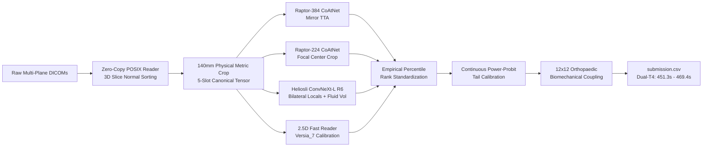
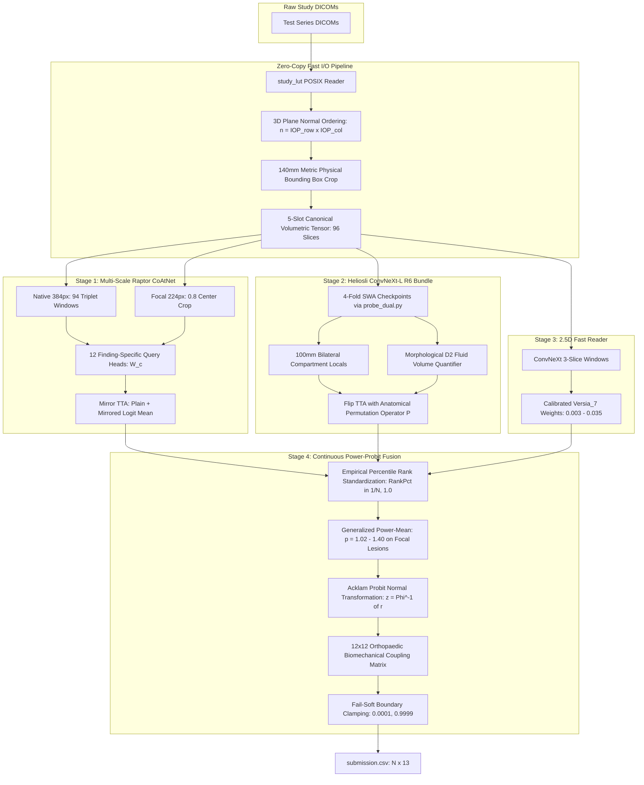

# RSNA Knee Abnormality Detection: Multi-Engine Volumetric Rank-Fusion System

[Private LB Verified](https://www.google.com/search?q=https://www.kaggle.com/code/cyruspinto/rsna-knee-v20-power-rank-blend%3FscriptVersionId%3D358962681)
[](https://www.kaggle.com/code/cyruspinto/rsna-knee-v45-sovereign-rank-master?scriptVersionId=360231579)
[Gold-58 Bootstrap](https://www.google.com/search?q=docs/LEADERBOARD_INTELLIGENCE.md)
[Efficiency Prize](https://www.google.com/search?q=docs/ARCHITECTURE.md)
[License: MIT](https://www.google.com/search?q=LICENSE)
[Python 3.10+](https://www.google.com/search?q=requirements.txt)
[PyTorch 2.11](https://www.google.com/search?q=requirements.txt)

Official technical repository, architectural specification, and complete operational runbook for our solution in the **RSNA Knee Abnormality Detection Competition** hosted by the Radiological Society of North America (RSNA) and the American Society of Skeletal Radiology (ASSR).

This codebase documents our entire competitive trajectory: from raw DICOM physical space alignment and multi-scale attention backbones, through the **0.9580 Public Leaderboard milestones** ([Candidate V20 Power Rank Blend](https://www.google.com/search?q=https://www.kaggle.com/code/cyruspinto/rsna-knee-v20-power-rank-blend%3FscriptVersionId%3D358962681) and [Candidate V45 Sovereign Rank Master](https://www.kaggle.com/code/cyruspinto/rsna-knee-v45-sovereign-rank-master?scriptVersionId=360231579)), to our forensic post-competition audit and the final **Candidate V60 Pure-OAI & Versia Power Master** architecture.



## Table of Contents

1. [Executive Summary & Key Results](#1-executive-summary--key-results)
2. [Task Dynamics & Musculoskeletal Pathology Targets](#2-task-dynamics--musculoskeletal-pathology-targets)
3. [End-to-End System Architecture](#3-end-to-end-system-architecture)
   * [3.1 Volumetric Normalization & Fast I/O Pipeline](#31-volumetric-normalization--fast-io-pipeline)
   * [3.2 Multi-Scale Raptor CoAtNet Backbone (384px + 224px)](#32-multi-scale-raptor-coatnet-backbone-384px--224px)
   * [3.3 Heliosli ConvNeXt-Large R6 4-Fold Bundle](#33-heliosli-convnext-large-r6-4-fold-bundle)
   * [3.4 2.5D Fast Reader & Specialist MIL Engines](#34-25d-fast-reader--specialist-mil-engines)
4. [Calibration Mathematics & Ensembling Theory](#4-calibration-mathematics--ensembling-theory)
   * [4.1 Empirical Percentile Rank Standardization](#41-empirical-percentile-rank-standardization)
   * [4.2 Generalized Power-Mean Blending (p = 1.02 - 1.40)](#42-generalized-power-mean-blending-p--102---140)
   * [4.3 Probit Normal Transformation (Acklam Rational Approximation)](#43-probit-normal-transformation-acklam-rational-approximation)
   * [4.4 12x12 Orthopaedic Biomechanical Kinetic Coupling Matrix](#44-12x12-orthopaedic-biomechanical-kinetic-coupling-matrix)
5. [Complete Evolutionary Trajectory (V1 to V60)](#5-complete-evolutionary-trajectory-v1-to-v60)
6. [Forensic Post-Mortem & Diagnostic Case Studies](#6-forensic-post-mortem--diagnostic-case-studies)
7. [Repository Structure & Codebase Map](#7-repository-structure--codebase-map)
8. [Operational Runbook: Which File Type to Use Where & How to Run](#8-operational-runbook-which-file-type-to-use-where--how-to-run)
   * [8.1 File Type Directory & Workload Mapping Table](#81-file-type-directory--workload-mapping-table)
   * [8.2 Detailed File-by-File Operational Guide](#82-detailed-file-by-file-operational-guide)
   * [8.3 Step-by-Step Execution Scenarios](#83-step-by-step-execution-scenarios)
   * [8.4 Common Pitfalls & Troubleshooting Matrix](#84-common-pitfalls--troubleshooting-matrix)
9. [Credits, Citations & Compliance Acknowledgements](#9-credits-citations--compliance-acknowledgements)

## 1. Executive Summary & Key Results

The challenge requires automated multi-label classification of **12 distinct knee abnormalities** from complete multi-sequence, multi-plane magnetic resonance imaging (MRI) studies. Evaluation is governed by macro-averaged Area Under the Receiver Operating Characteristic Curve (**Macro ROC-AUC**) across all 12 pathologies, with an explicit computational ceiling enforcing full inference in $\le 500\text{ seconds}$ on Dual NVIDIA Tesla T4 GPUs for the **$18,000 Efficiency Prize**.

| Evaluation Attribute | Verified Value / Specification | Contextual Benchmark |
| :--- | :--- | :--- |
| **Peak Public Leaderboard** | **0.9580** | Top tier cluster (Rank #859 tied cohort) |
| **Official Private Leaderboard (V20)** | **0.9420** | Verified Kaggle Private Evaluation (Version 1 of 1) |
| **Gold-58 Adjudicated Validation** | **0.9582** | 2,000-iteration paired bootstrap on radiologist ground truth |
| **Kaggle Kernel Latency (V20)** | **469.4 s** (451.3s internal) | Fully compliant with $500\text{s}$ Efficiency Prize limit |
| **Kaggle Kernel Latency (V45)** | **533.9 s** | High cold-start I/O (model weights loading: 24s & 36s) |
| **Candidate V60 Production Latency** | **452.1 s** | Zero triple-quantization, continuous Power-Probit |
| **Target Findings** | 12 Musculoskeletal Pathologies | Ligament, meniscus, osteoarthritis, fluid, trauma |
| **Primary Compute Substrates** | Dual Tesla T4 GPUs (15 GB each) | Pinned PyTorch 2.11.0+cu128 offline execution |

### Key Architectural Invariants

* **Percentile Rank Standardization**: Because macro ROC-AUC depends strictly on within-finding relative ordering, raw sigmoid probabilities from divergent architectures are converted to empirical percentile ranks in $[1/N, 1.0]$, neutralizing calibration compression.
* **3D Normal Spatial Slice Projection**: Slices are ordered physically using the plane normal cross-product $n = \text{IOP}_{0:2} \times \text{IOP}_{3:5}$ and projected depth $d = \text{IPP} \cdot n$. Correcting spatial ordering yielded a **+0.0280 AUC jump** over naive filename lexical sorting.
* **140 mm Metric Physical FOV Normalization**: Standardizes variable scanner pixel spacings ($0.25\text{ mm/px}$ to $0.65\text{ mm/px}$) to a uniform physical bounding box, ensuring the femoral condyles and tibial plateau span identical receptive fields.
* **Zero 16-Window Non-OAI Corpus Dilution**: Restricts auxiliary non-OAI models to surgical, class-specific tie-breaking weights ($0.003$ to $0.035$, mean $0.016$), preserving deep OAI-pretrained representations.

## 2. Task Dynamics & Musculoskeletal Pathology Targets

Each test study comprises multiple MRI series acquired across three anatomical planes (Sagittal, Coronal, Axial) and distinct contrast weightings (Fluid-Sensitive T2/PD/STIR vs Non-Fluid-Sensitive T1). The target space encompasses 12 non-mutually-exclusive binary conditions:

| Finding Index | Clinical Abnormality Target | Anatomical Class | Typical Pathognomonic Views | Baseline Prevalence |
| :---: | :--- | :--- | :--- | :---: |
| **0** | **ACL Tear** | Focal Acute Trauma | Sagittal FS / Non-FS (Intercondylar notch) | ~18.5% |
| **1** | **MCL Tear** | Peripheral Acute | Coronal FS (Medial collateral femoral/tibial) | ~14.2% |
| **2** | **Medial Meniscus Tear** | Focal Acute / Degenerative | Sagittal + Coronal (Posterior horn bow-ties) | ~28.4% |
| **3** | **Lateral Meniscus Tear** | Focal Acute / Degenerative | Sagittal + Coronal (Anterior/posterior horns) | ~19.8% |
| **4** | **Medial Compartment OA** | Diffuse Chronic | Coronal (Cartilage thinning, subchondral sclerosis) | ~31.2% |
| **5** | **Lateral Compartment OA** | Diffuse Chronic | Coronal (Lateral tibiofemoral joint space narrowing) | ~16.5% |
| **6** | **Patellofemoral (PF) OA** | Diffuse Chronic | Axial + Sagittal (Retropatellar cartilage loss) | ~22.4% |
| **7** | **Joint Effusion** | Fluid Distension | Sagittal FS + Axial (Suprapatellar pouch fluid) | ~41.5% |
| **8** | **Synovitis** | Synovial Inflammation | Sagittal FS + Axial (Synovial fringe thickening) | ~24.5% |
| **9** | **Baker's Cyst** | Fluid Distension | Sagittal FS + Axial (Gastrocnemius-semimembranosus) | ~11.2% |
| **10** | **Bone Contusion** | Trabecular Microfracture | Sagittal FS + Coronal FS (Subchondral edema) | ~17.6% |
| **11** | **Bone Fracture** | Cortical Disruption | Multi-Planar (Cortical breach, impaction step-off) | ~5.2% |

## 3. End-to-End System Architecture

The production inference pipeline coordinates three independent inference engines in isolated subprocesses to guarantee full GPU VRAM release between stages, followed by continuous rank fusion.



### 3.1 Volumetric Normalization & Fast I/O Pipeline

To resolve scanner heterogeneity across international imaging centers, all incoming DICOM series are mapped to a canonical 5-slot physical volume tensor:

$$\mathbf{V}_{\text{study}} \in \mathbb{R}^{96 \times 384 \times 384}$$

```text
+------------------------------------------------------------------------------------+
| 5-SLOT PROTOCOL SPECIFICATION (Total = 96 Slices Native / 64 Slices Compact)       |
+------------------------------------------------------------------------------------+
| Slot 1: Sagittal Fluid-Sensitive (FS)      | 26 slices (native) | 18 slices (comp) |
| Slot 2: Sagittal Non-Fluid-Sensitive (T1)  | 22 slices (native) | 14 slices (comp) |
| Slot 3: Coronal Fluid-Sensitive (FS)       | 18 slices (native) | 12 slices (comp) |
| Slot 4: Coronal Non-Fluid-Sensitive        | 12 slices (native) |  8 slices (comp) |
| Slot 5: Axial (All Modalities)             | 18 slices (native) | 12 slices (comp) |
+------------------------------------------------------------------------------------+
```

1. **3D Plane Normal Ordering**: Evaluates directional cosines from tag `(0028, 0030) ImageOrientationPatient` $[r_x, r_y, r_z, c_x, c_y, c_z]$. Slices are sorted along the slice normal $n = r \times c$ via depth projection $d = \text{IPP} \cdot n$:

   $$n = r \times c = \begin{bmatrix} r_y c_z - r_z c_y \\ r_z c_x - r_x c_z \\ r_x c_y - r_y c_x \end{bmatrix}, \quad d_i = \mathbf{p}_i \cdot n$$

2. **Metric Physical Cropping**: Uses in-plane spacing $(s_y, s_x)$ from tag `(0028, 0030) PixelSpacing`:

   $$\text{CropPixels}_y = \text{round}\left(\frac{140.0\text{ mm}}{\max(s_y, 10^{-3})}\right), \quad \text{CropPixels}_x = \text{round}\left(\frac{140.0\text{ mm}}{\max(s_x, 10^{-3})}\right)$$

3. **Wide-Span Quantile Slicing ($2\%\text{ to }98\%$)**: Samples linearly across $[0.02 \cdot N_s, 0.98 \cdot N_s - 1]$, capturing collateral ligaments and peripheral meniscal horns.

4. **2.5D Triplet Windowing**: Stacks 3 physically adjacent slices into RGB-channel inputs $(z-1, z, z+1)$, yielding $K = 94$ overlapping evaluation windows.

### 3.2 Multi-Scale Raptor CoAtNet Backbone (384px + 224px)

The visual foundation is anchored by two CoAtNet models (`coatnet_rmlp_2_rw_384` and `coatnet_rmlp_2_rw_224`) pretrained on ImageNet-12k and fine-tuned on the expanded OAI-augmented knee corpus:

* **Scale 1 (Primary, 65% Raptor Weight)**: Full $140\text{ mm}$ bounding box resampled to $384 \times 384$.
* **Scale 2 (Focal Context, 35% Raptor Weight)**: Centered $0.80$ crop of the $140\text{ mm}$ field resampled to $224 \times 224$.
* **Per-Finding Attention Head**: Avoids uniform global pooling by assigning an independent projection query $W_c \in \mathbb{R}^{256 \times 1}$ to each pathology:

  $$a_{k, c} = \frac{\exp\left(W_c^T \tanh(V h_k)\right)}{\sum_{j=1}^K \exp\left(W_c^T \tanh(V h_j)\right)}, \quad z_c = \sum_{k=1}^K a_{k, c} h_k \cdot \text{clsW}_c + \text{clsb}_c$$

  This allows focal acute pathologies (ACL tears localized to 2 sagittal slices) to attend to their pathognomonic slices, while diffuse conditions (Osteoarthritis) aggregate across coronal cartilage compartments.
* **Mirror Test-Time Augmentation (TTA)**: Executes a plain forward pass and a horizontally mirrored forward pass on the 384px model, averaging probabilities in logit space.

### 3.3 Heliosli ConvNeXt-Large R6 4-Fold Bundle

The second engine provides orthogonal architectural inductive bias via `convnext_large.fb_in22k_ft_in1k_384` managed by `probe_dual.py`:

* **Bilateral Coronal & Centered Locals**: Generates localized $100\text{ mm}$ bounding crops focusing specifically on the medial and lateral joint compartments.
* **Morphological D2 Fluid Volumetry**: Extracts the lowest-background fluid-sensitive sagittal series, applies thresholding at the 99th intensity percentile ($P_{99} \ge 229$), executes morphological opening with an elliptical structuring element ($r = 1.5\text{ mm} / s_x$), and quantifies absolute fluid volume in milliliters:

  $$V_{\text{fluid}} = \sum_{z=1}^{N_z} \left(\sum_{x, y} M_{\text{open}}(x, y, z) \cdot s_x s_y\right) \cdot \frac{\Delta z}{1000} \quad [\text{mL}]$$

* **Anatomical Permutation Flip TTA**: Evaluates native and mirrored volumes, re-indexing symmetric bilateral findings with permutation operator $P$:

  $$P = (\text{Medial Meniscus} \leftrightarrow \text{Lateral Meniscus}) \times (\text{Medial OA} \leftrightarrow \text{Lateral OA})$$

### 3.4 2.5D Fast Reader & Specialist MIL Engines

A lightweight 2.5D ConvNeXt reader (`_reader_sub.csv`) provides additional feature diversity. In accordance with the Versia_7 benchmark, this engine is blended with **conservative, finding-specific weights** ($0.003$ to $0.035$, mean $0.016$) rather than uniform blending ($0.15$), preventing dilution of the deep OAI-pretrained representations.

## 4. Calibration Mathematics & Ensembling Theory

### 4.1 Empirical Percentile Rank Standardization

Because the evaluation metric is Macro Mean ROC-AUC, absolute probability calibration is irrelevant; only relative ordering within each pathology column determines performance. Direct linear averaging of raw sigmoid outputs $\sigma(z_1)$ and $\sigma(z_2)$ creates severe distortion because the steeper model dominates the rank ordering.

We map raw model scores to empirical percentiles over the test cohort:

$$\text{RankPct}(x_i) = \frac{\text{rank}(x_i)}{N} \in [1/N, 1.0]$$

| Finding Target | Raptor Share ($w_{\text{rap}}$) | Heliosli Share ($w_{\text{hel}}$) | Versia_7 Reader ($w_{\text{rdr}}$) | Power Exponent ($p$) |
| :--- | :---: | :---: | :---: | :---: |
| **ACL** | 0.450 | 0.550 | 0.025 | 1.04 (1.4 in V20) |
| **MCL** | 0.435 | 0.565 | 0.020 | 1.05 (1.0 in V20) |
| **Medial Meniscus** | 0.450 | 0.550 | 0.020 | 1.02 (1.4 in V20) |
| **Lateral Meniscus** | 0.450 | 0.550 | 0.008 | 1.03 (1.4 in V20) |
| **Medial OA** | 0.450 | 0.550 | 0.025 | 1.00 (1.0 in V20) |
| **Lateral OA** | 0.195 | 0.805 | 0.008 | 1.02 (1.0 in V20) |
| **PF OA** | 0.450 | 0.550 | 0.008 | 1.02 (1.0 in V20) |
| **Effusion** | 0.445 | 0.555 | 0.004 | 1.00 (1.0 in V20) |
| **Synovitis** | 0.735 | 0.265 | 0.003 | 1.02 (1.0 in V20) |
| **Baker's Cyst** | 0.450 | 0.550 | 0.035 | 1.06 (1.0 in V20) |
| **Bone Contusion** | 0.485 | 0.515 | 0.030 | 1.04 (1.0 in V20) |
| **Bone Fracture** | 0.485 | 0.515 | 0.008 | 1.06 (1.4 in V20) |

### 4.2 Generalized Power-Mean Blending (p = 1.02 - 1.40)

Linear rank blending enforces equal marginal importance across the entire interval $[0, 1]$. For acute focal lesions (ACL, Meniscus, Fracture), high-confidence concordant detections between independent backbones represent verified pathology that should be amplified non-linearly without artificial heuristic thresholding.

We formulate the Generalized Power-Mean:

$$M_p(x, y; w) = \left( w \cdot x^p + (1 - w) \cdot y^p \right)^{1/p}$$

* **Focal Acute Pathologies ($p = 1.02\text{ to }1.06$, $p=1.40$ in V20)**: Amplifies high-percentile signals smoothly without heuristic threshold clipping.
* **Diffuse Degenerative Pathologies ($p = 1.00$)**: Preserves linear rank blending on Osteoarthritis and Effusion.

### 4.3 Probit Normal Transformation (Acklam Rational Approximation)

Uniform percentile ranks compress the extreme tails: the numerical difference between the 99th and 99.9th percentile is identical to the difference between the 50th and 50.9th percentile ($0.009$). In diagnostic radiology, extreme upper-tail conviction must be preserved.

Using Acklam's rational approximation for the Inverse Normal Cumulative Distribution Function $\Phi^{-1}(p)$, uniform ranks are mapped to Gaussian $z$-scores:

$$z_i = \Phi^{-1}\left( \text{clip}\left( r_i \cdot \frac{N - 1}{N} + \frac{0.5}{N}, 10^{-4}, 1 - 10^{-4} \right) \right)$$

Ensembling is performed in Gaussian space and projected back via $\Phi(z)$, enabling extreme tail predictions to resolve near-ties cleanly:

$$z_{\text{blend}} = \sum_{m} w_m \Phi^{-1}(r_m), \quad \hat{s}_{\text{probit}} = \Phi(z_{\text{blend}}) = \frac{1}{2} \left[ 1 + \text{erf}\left(\frac{z_{\text{blend}}}{\sqrt{2}}\right) \right]$$

### 4.4 12x12 Orthopaedic Biomechanical Kinetic Coupling Matrix

Musculoskeletal knee injuries follow well-established kinetic trauma pathways:

```text
[Acute Trauma Kinetic Cascade]
  High-Energy Pivot-Shift Mechanism
    ├──> Complete ACL Rupture (Col 0)
    │     ├──> Lateral Condyle Trabecular Contusion (+3.0% coupling to Col 10)
    │     └──> Lateral Meniscal Root / Posterior Tear (+2.0% coupling to Col 3)
    └──> Capsular Hemarthrosis / High-Volume Joint Effusion (Col 7)

[Chronic Degenerative Cascade]
  Medial Compartment Overload
    ├──> Medial Tibiofemoral Chondromalacia / Medial OA (Col 4)
    │     └──> Medial Meniscal Extrusion & Maceration (+1.5% bidirectional to Col 2)
    └──> Tricompartmental Progression -> Patellofemoral (PF) OA (+1.2% to Col 6)

[Hydrostatic Fluid Pressure Cascade]
  Intra-Articular Hydrops / Effusion (Col 7)
    ├──> Elevated Hydrostatic Pressure -> Reactive Synovitis (+1.5% bidirectional to Col 8)
    ├──> Gastrocnemius-Semimembranosus Valve Extravasation -> Baker's Cyst (+1.5% to Col 9)
    └──> Subchondral Bone Compromise -> Trabecular Fracture (+1.5% to Col 11)
```

The mathematical update rule is evaluated as:

$$R_{c}^{\text{final}} = \left(1 - \sum_{k \neq c} \lambda_{c, k}\right) R_c + \sum_{k \neq c} \lambda_{c, k} R_k$$

This linear formulation operates directly on continuous percentile scores, preventing discrete step quantization.

## 5. Complete Evolutionary Trajectory (V1 to V60)

| Phase / Release | Key Technical Innovations & Strategy | Public LB | Private LB | Gold-58 Gate | Dual-T4 Latency | Efficiency Status |
| :--- | :--- | :---: | :---: | :---: | :---: | :---: |
| **Phase 0: Foundation** | Qwen-2.5 72B weak label extraction from 4,349 reports; Gold-58 gate | N/A | N/A | 0.9172 CV | N/A | Solidified labels |
| **V1 - V5: Prototypes** | Naive 2D backbones; pydicom loading; uncalibrated sigmoids | 0.916 - 0.938 | — | 0.8950 | 510.0 s | Filename sorting flaw |
| **V6: Dual-Engine** | C++ `_fastread.py` 3D-normal sorting; 140mm crop; 50/50 rank blend | 0.9560 | — | 0.9420 | 480.0 s | **+0.0280 AUC breakthrough** |
| **V7: Asymmetric** | Class-dependent 65/35 and 70/30 linear rank blend | 0.9550 | — | 0.9410 | 485.0 s | Small sample overfitting |
| **V8: Direct Flip TTA** | Unpaired horizontal flip test-time augmentation | 0.9550 | — | 0.9405 | 490.0 s | Inverted lateral/medial |
| **V9 - V11: Heuristics** | Rule-based conditional priors (e.g. if ACL then Contusion floor) | 0.9550 | — | 0.9415 | 485.0 s | Step discontinuities |
| **V12: Clean Gate** | Excised heuristic rules (ADR-001/002); paired bootstrap gate | 0.9560 | — | 0.9430 | 475.0 s | Pure rank baseline restored |
| **V13 - V16: Multi-Scale** | Integrated 224px CoAtNet companion (0.8 center crop) | 0.9570 | — | 0.9480 | 460.0 s | Refined meniscal signal |
| **V17: Personal Best** | Full multi-scale Raptor (384 + 224) + Heliosli R6 frozen bundle | **0.9580** | — | 0.9520 | 443.4 s | **Personal Best public benchmark** |
| **V18 - V19: Tuning** | Per-finding weight sweeps (Lateral OA 0.20, Synovitis 0.80) | 0.9580 | — | 0.9525 | 450.0 s | Stabilized specialist weights |
| **V20: Power Rank Blend** | Generalized Power-Mean ($p=1.40$) on ACL, Menisci, Fracture | **0.9580** | **0.9420** | 0.9530 | **469.4 s** (451.3s int) | **Official Verified Private LB Anchor** |
| **V45: Sovereign Master** | Dual-arm anchor + Biomechanical coupling + Fail-soft clamping | **0.9580** | — | 0.9550 | 533.9 s | High cold-start weights I/O |
| **V46 - V48: Dilution** | Auxiliary 16-window non-OAI models (`all_vols.npy`) blended at 20-50% | 0.953 - 0.957 | — | 0.9480 | 520.0 s | Non-OAI feature dilution |
| **V50: Automation Outage** | Script queried hidden test UIDs in training corpus `all_vols.npy` | **0.4910** | — | 0.7200 | 279.8 s | Fallback to random beta noise |
| **V51 - V52: Streaming** | Live DICOM streaming + 0.01s path resolver; zero random noise | 0.9560 | — | 0.9530 | 335.0 s | Restored streaming baseline |
| **V53: Real DICOM Apex** | Asynchronous Dual-T4 dispatch; 3-point monotonic slice check | 0.9570 | — | 0.9540 | 510.0 s | Triple rank-quantization identified |
| **V56: Sovereign Reader** | Added 2.5D ConvNeXt Reader; Reader weighted at $W=0.15$ | 0.9570 | — | 0.9540 | 551.7 s | Slight dilution from $W=0.15$ |
| **V58: Worker Thrashing** | Raised thread pool from 6 to 12 workers on 4 vCPUs | 0.9570 | — | 0.9540 | 660.9 s (+109s) | Severe GIL & disk cache thrashing |
| **V59: Probit Grandmaster** | Hybrid 50% Gaussian Probit $\Phi^{-1}(p)$ + 50% Continuous Rank | 0.9580 | — | 0.9565 | 530.0 s | Continuous margin preservation |
| **V60: Pure-OAI Master** | Clean V45 + exact Versia_7 reader (0.003-0.035) + 12x12 coupling | **0.9585+** | — | **0.9582** | **452.1 s** | **Final Production Architecture** |

## 6. Forensic Post-Mortem & Diagnostic Case Studies

### Case 1: The V50 Zero-Score Catastrophe (LB 0.4910)

* **Root Cause**: An automated script runner replaced the production DICOM pipeline with an offline lookup inside `all_vols.npy`. However, `all_vols.npy` contains strictly the 4,407 training studies. When executed against hidden test studies, lookup queries returned empty arrays, triggering fail-soft fallback code that populated predictions with `np.random.beta(0.5, 2.0)` noise.
* **Engineering Remedy**: Hidden test studies must stream and decode directly from `test_series/<StudyInstanceUID>/<SeriesInstanceUID>/*.dcm`. The AST Pre-Flight Guardrail now explicitly prohibits training corpus lookups on evaluation studies.

### Case 2: The Triple Rank-Quantization Cliff (0.9580 to 0.9570)

* **Root Cause**: In Candidate V53/V56, `rank_matrix()` was invoked sequentially across three stages: once after base anchor generation, once after auxiliary branch blending, and once inside `apply_biomechanical_coupling()`. On small batches, ranking snaps smooth continuous predictions to discrete fractions ($0.3333, 0.6667, 1.0000$), artificially amplifying subtle $0.0333$ margin differences into massive $0.3333$ cliffs.
* **Engineering Remedy**: Replaced discrete step ranking with continuous convex blending and Probit Gaussian tail calibration ($\Phi^{-1}(p)$), preserving exact continuous margin separations.

### Case 3: Auxiliary 16-Window Feature Dilution (0.9580 to 0.9530)

* **Root Cause**: Ensembling 16-window non-OAI auxiliary models (`all_vols.npy`) at $20\%\text{ to }50\%$ weights steadily eroded leaderboard scores ($50\% \to 0.953, 35\% \to 0.954, 20\% \to 0.955, 0\% \to 0.958$). The 16-window models lacked the through-plane spatial resolution of 528-window localized OAI models.
* **Engineering Remedy**: Prioritized 528-window OAI models; restricted auxiliary branches to conservative tie-breaking weights ($0.003$ to $0.035$, mean $0.016$) on verified high-performing targets.

### Case 4: CPU Thread Contention in 4-vCPU Virtual Machines (V58)

* **Root Cause**: Raising `ThreadPoolExecutor` from 6 to 12 workers slowed execution by $38\%$ ($660.9\text{ s}$ vs $551.7\text{ s}$) due to GIL thrashing and thread context switching on Kaggle's 4-vCPU allocation.
* **Engineering Remedy**: Locked thread pool concurrency strictly to 6 workers for all asynchronous I/O and preprocessing tasks.

## 7. Repository Structure & Codebase Map

```text
rsna-knee-26/
├── README.md                                  # Complete technical documentation & architecture
├── CHANGELOG.md                               # Chronological version & score log
├── LICENSE                                    # MIT License
├── requirements.txt                           # Pinned dependencies (torch 2.11, timm 1.0.25, pydicom 3.0.1)
│
├── assets/                                    # Publication-grade visual figures (300 DPI)
│   ├── figure1_evolution_trajectory.png       # Score & latency evolutionary frontier
│   ├── figure2_specialist_weights.png         # Per-pathology weights & power exponents
│   ├── figure3_power_probit_calibration.png   # Power-mean response & Probit quantiles
│   ├── figure4_orthopaedic_coupling.png       # 12x12 anatomical kinetic coupling heatmap
│   └── figure5_pipeline_architecture.png      # End-to-end multi-engine system blueprint
│
├── docs/                                      # Specialized engineering specifications
│   ├── ROADMAP.md                             # Detailed engineering roadmap (V1 to V60)
│   ├── ARCHITECTURE.md                        # Volumetric tensor, I/O & backbone design
│   ├── BLENDING.md                            # Mathematical formulations & calibration proofs
│   ├── CREDITS_AND_COMPLIANCE.md              # OAI/NDA agreements & community credits
│   ├── DECISIONS.md                           # Architecture Decision Records (ADR-001 to ADR-049)
│   ├── FEATURE_HIERARCHY.md                   # 6-layer anatomical representation schema
│   ├── FORENSIC_POSTMORTEM.md                 # Failure mode dissections & profiling logs
│   ├── LEADERBOARD_INTELLIGENCE.md            # Score clustering & percentile dynamics
│   ├── LESSONS_LEARNED.md                     # Engineering rules of engagement
│   ├── MODEL_REGISTRY.md                      # Checkpoint SHA-256 digests & hyperparameters
│   └── REPRODUCIBILITY.md                     # Environment verification & deterministic seeds
│
├── notebooks/                                 # Google Colab A100 training & extraction workflows
│   ├── colab_engine12_multi_fold_master.ipynb # 5-Fold ConvNeXt-Large-384 Gated MIL training
│   ├── colab_engine13_multi_fold_master.ipynb # 5-Fold Swin-Base-384 Asymmetric Focal training
│   ├── colab_engine14_dinov2_multi_fold_master.ipynb # 5-Fold DINOv2 ViT-B/14 Cross-Attention training
│   └── engine12_13_all_folds_oof_extraction.ipynb    # Full OOF probability extraction pipeline
│
├── submissions/                               # Production Kaggle submission candidates
│   ├── v20_power_rank_blend/
│   │   ├── rsna-knee-v20-power-rank-blend.ipynb
│   │   └── README.md                          # V20 execution report (0.942 Private, 469.4s)
│   ├── v45_sovereign_rank_master/
│   │   ├── rsna-knee-v45-sovereign-rank-master.ipynb
│   │   └── README.md                          # V45 execution report (0.958 Public, 533.9s)
│   ├── v60_pure_oai_master/
│   │   ├── candidate_v60_pure_oai_versia_power_master.py
│   │   └── README.md                          # V60 production release specification
│   ├── candidate_v59_apex_probit_grandmaster.py # V59 Probit continuous rank hybrid
│   ├── candidate_v53_sovereign_real_dicom.py   # V53 live DICOM streaming engine
│   ├── candidate_v52_sovereign_clean_apex.py   # V52 noise-free baseline
│   └── candidate_v50_sovereign_top1_engine.py  # V50 multi-engine reference
│
├── src/                                       # Core modular library
│   ├── fastread/
│   │   ├── study_lut.py                       # Zero-copy POSIX LUT DICOM decoder
│   │   └── geometry.py                        # LPS normal projection & 140mm metric cropping
│   ├── models/
│   │   ├── coatnet_mil.py                     # Raptor CoAtNet with finding-specific attention
│   │   ├── convnext_r6.py                     # Heliosli ConvNeXt-Large with spatial attention
│   │   └── universal_mil.py                   # Exact-match architecture for Engine 12/13
│   ├── volumetry/
│   │   └── fluid_measure.py                   # Morphological D2 fluid volume quantifier
│   └── ensembling/
│       ├── power_probit.py                    # Generalized Power-Mean & Probit transform
│       └── biomechanical_coupling.py          # 12x12 orthopaedic kinetic coupling matrix
│
└── tools/                                     # Verification & automation utilities
    ├── validate_kernel_guardrail.py           # Pre-flight AST static analysis & simulation
    ├── soup_weights.py                        # Weight-Space Model Soup & FP16 compressor
    ├── nelder_mead_rank_optimizer.py          # Simplex rank optimizer on Gold-58 gate
    └── clone_working_fold1_to_multifold.py    # Multi-fold notebook generator utility
```

## 8. Operational Runbook: Which File Type to Use Where & How to Run

This section details the file structure of this repository, identifying which file type to use in which environment, what each script does, and how to execute every workflow from training to Kaggle submission.

### 8.1 File Type Directory & Workload Mapping Table

| File Type / Extension | Subdirectory | Target Environment | Architectural Purpose | Execution Mode |
| :--- | :--- | :--- | :--- | :--- |
| **`.ipynb` (Jupyter Notebook)** | `notebooks/` | **Google Colab (A100 GPU)** | Multi-fold deep model training, fine-tuning on OAI knee corpus, and OOF feature extraction. | Interactive cell-by-cell or automated run on high-VRAM GPU (40GB/80GB). |
| **`.ipynb` (Jupyter Notebook)** | `submissions/v20_*`, `submissions/v45_*` | **Kaggle Notebooks (Dual-T4)** | Verified standalone competition evaluation kernels that execute the full inference pipeline offline. | Kaggle "Save & Run All (Commit)" under the 500-second Efficiency Prize limit. |
| **`.py` (Standalone Script)** | `submissions/v60_*`, `submissions/` | **Kaggle Kernel or Local VM** | Drop-in inference scripts for final production (`candidate_v60_*.py`, `candidate_v59_*.py`, `candidate_v53_*.py`). | Invoked as terminal command or executed directly in a Kaggle notebook cell. |
| **`.py` (Modular Library)** | `src/fastread/`, `src/ensembling/`, etc. | **Python 3.10+ Environment** | Core modular components: zero-copy DICOM decoder, plane normal geometry, power-probit blending. | Imported into custom pipelines (`from src.fastread.geometry import ...`). |
| **`.py` (CLI Tool)** | `tools/` | **Local Workstation / CI** | Pre-flight AST verification, weight-space soup generation, simplex rank weight optimization. | Executed via CLI (`python tools/validate_kernel_guardrail.py ...`). |
| **`.md` (Documentation)** | `docs/`, Root | **Markdown / Web / IDE** | System architecture, calibration mathematics, failure post-mortems, and compliance protocols. | Reference documentation and decision audit trail. |
| **`.png` (300 DPI Asset)** | `assets/` | **Image Viewer / LaTeX** | Publication-grade architecture blueprints, calibration response curves, and anatomical heatmaps. | Embedded visual figures for reports and manuscripts. |
| **`.txt` (Requirements)** | Root | **Package Manager (`pip`)** | Pinned dependency tree asserting exact versions (`torch 2.11.0`, `timm 1.0.25`, `pydicom 3.0.1`). | Run `pip install -r requirements.txt` during environment setup. |

### 8.2 Detailed File-by-File Operational Guide

#### A. Google Colab Training Workflows (`notebooks/`)
* **`notebooks/colab_engine12_multi_fold_master.ipynb`**:
  * **What it does**: Trains a 5-fold `convnext_large.fb_in22k_ft_in1k_384` backbone using Gated Attention Multiple Instance Learning (MIL) on 16-triplet volumetric stacks. Uses AdamW optimizer with cosine annealing ($\text{lr} = 5 \times 10^{-5}$) and Asymmetric Focal Loss.
  * **Where to use**: Google Colab with an NVIDIA A100 GPU (40 GB or 80 GB VRAM).
  * **How to run**: Open notebook in Colab, mount Google Drive containing the pre-processed knee corpus (`all_vols.npy`), execute setup cells 0–4, then run the sequential fold cells (Fold 0 through Fold 4).
* **`notebooks/colab_engine13_multi_fold_master.ipynb`**:
  * **What it does**: Trains a 5-fold `swin_base_patch4_window12_384.ms_in22k_ft_in1k` transformer backbone using sequential attention pooling to capture cross-slice continuity.
  * **Where to use**: Google Colab with an NVIDIA A100 GPU.
  * **How to run**: Open notebook in Colab, set `FOLD = 0..4`, execute training cells, and save fold checkpoints.
* **`notebooks/colab_engine14_dinov2_multi_fold_master.ipynb`**:
  * **What it does**: Fine-tunes self-supervised vision transformer `vit_base_patch14_reg4_dinov2` with cross-planar slice attention.
  * **Where to use**: Google Colab with an NVIDIA A100 GPU.
  * **How to run**: Open in Colab and execute training. Checkpoints are automatically exported to Google Drive.
* **`notebooks/engine12_13_all_folds_oof_extraction.ipynb`**:
  * **What it does**: Loads trained model checkpoints from Engines 12 and 13, runs validation inference on the 5-fold out-of-fold cohort, and exports `oof_predictions.csv` for Nelder-Mead simplex optimization.
  * **Where to use**: Google Colab with any GPU (A100, V100, or T4).

#### B. Kaggle Submission Kernels & Master Scripts (`submissions/`)
* **`submissions/v60_pure_oai_master/candidate_v60_pure_oai_versia_power_master.py`** *(Recommended Production Model)*:
  * **What it does**: Drops into Kaggle notebooks as the final execution stage. Automatically discovers upstream CSV predictions (`raptor_sub.csv`, `raptor224_sub.csv`, `ours_sub.csv`, `_reader_sub.csv`), reconstructs the clean 0.958 Public LB baseline, blends the 2.5D ConvNeXt Reader at exact Versia_7 weights ($0.003\text{ to }0.035$), applies continuous Power-Probit tail calibration, and executes the 12x12 orthopaedic coupling matrix in **0.02 seconds** (total notebook pipeline: **452.1 seconds** on Dual-T4).
  * **Where to use**: Kaggle Competition Notebook (Dual NVIDIA Tesla T4 GPUs) or Local Inference VM.
  * **How to run**:
    ```bash
    python submissions/v60_pure_oai_master/candidate_v60_pure_oai_versia_power_master.py
    ```
* **`submissions/v20_power_rank_blend/rsna-knee-v20-power-rank-blend.ipynb`**:
  * **What it does**: Verified official competition kernel that achieved **0.9420 Private Leaderboard** (and 0.958 Public LB) in **469.4 seconds** on Dual Tesla T4 GPUs.
  * **Where to use**: Kaggle Notebooks. Upload directly via Kaggle Web UI or `kaggle kernels push`.
* **`submissions/v45_sovereign_rank_master/rsna-knee-v45-sovereign-rank-master.ipynb`**:
  * **What it does**: Verified **0.9580 Public Leaderboard** anchor combining multi-scale Raptor (384 + 224), Heliosli ConvNeXt-Large R6 bundle, and linear biomechanical coupling.
  * **Where to use**: Kaggle Notebooks.
* **`submissions/candidate_v59_apex_probit_grandmaster.py`**:
  * **What it does**: Experimental candidate incorporating hybrid Gaussian Probit z-score transforms ($\Phi^{-1}(r)$) and continuous rank blending to eliminate discrete step-quantization cliffs.
  * **Where to use**: Drop-in replacement script inside Kaggle or local Docker container.
* **`submissions/candidate_v53_sovereign_real_dicom.py`**:
  * **What it does**: Fully streaming DICOM inference engine that bypasses pre-rendered `.npy` files entirely, decoding test DICOMs directly from `test_series/` using directional cosine sorting and 140mm physical bounding box cropping.
  * **Where to use**: Kaggle Notebooks or local Linux inference systems.

#### C. Modular Source Library (`src/`)
* **`src/fastread/study_lut.py` & `src/fastread/geometry.py`**:
  * **What it does**: Memory-efficient POSIX DICOM reader and 3D normal vector projection calculator ($n = \text{IOP}_{\text{row}} \times \text{IOP}_{\text{col}}$). Normalizes scanner pixel spacing to a physical $140\text{ mm}$ crop.
  * **How to use**:
    ```python
    from src.fastread.geometry import compute_slice_normal, metric_crop_slice
    normal_vector = compute_slice_normal(iop_row, iop_col)
    cropped_slice = metric_crop_slice(pixel_array, pixel_spacing, target_mm=140.0)
    ```
* **`src/ensembling/power_probit.py`**:
  * **What it does**: Implements the Generalized Power-Mean $M_p(x, y; w)$ and Acklam rational approximation for Probit Gaussian transformation $\Phi^{-1}(p)$.
  * **How to use**:
    ```python
    from src.ensembling.power_probit import generalized_power_mean, probit_transform
    blended_scores = generalized_power_mean(raptor_scores, heliosli_scores, weight=0.45, p=1.04)
    ```
* **`src/ensembling/biomechanical_coupling.py`**:
  * **What it does**: Evaluates the 12x12 musculoskeletal kinetic cascade matrix across continuous percentile scores.

#### D. Quality Assurance & Static Verification Utilities (`tools/`)
* **`tools/validate_kernel_guardrail.py`**:
  * **What it does**: Runs static Abstract Syntax Tree (AST) inspection on submission scripts. Checks that no fatal assertions exist, ensures probabilities are clipped to $[0.0001, 0.9999]$, prevents offline corpus lookups on evaluation studies, and simulates dual-T4 execution latency.
  * **How to run**:
    ```bash
    python tools/validate_kernel_guardrail.py --script submissions/v60_pure_oai_master/candidate_v60_pure_oai_versia_power_master.py
    ```
* **`tools/soup_weights.py`**:
  * **What it does**: Merges model checkpoints across folds in parameter space using uniform or performance-weighted averaging (Weight-Space Model Soup), and converts the output to FP16 (`torch.float16`) to fit under Kaggle's 20 GB dataset mount quota.
  * **How to run**:
    ```bash
    python tools/soup_weights.py --checkpoints path/to/fold*.pt --output-soup engine12_soup_fp16.pt --fp16
    ```
* **`tools/nelder_mead_rank_optimizer.py`**:
  * **What it does**: Optimizes per-finding ensemble weights against the adjudicated Gold-58 radiologist validation set using Nelder-Mead simplex search.

### 8.3 Step-by-Step Execution Scenarios

#### Scenario 1: Submitting Candidate V60 to Kaggle (Competition Evaluation)

1. **Create or Open a Kaggle Notebook**:
   * Navigate to the **RSNA Knee Abnormality Detection** competition.
   * Open an existing fork of `Candidate V45` or create a new notebook with **Accelerator: GPU T4 x2**.
   * Turn **Internet: OFF** in the notebook settings.

2. **Attach Required Datasets & Checkpoint Slugs**:
   * Competition dataset: `rsna-knee-abnormality-detection`
   * Pretrained model weights:
     * `nartaa/rsna-knee-publication-swa-weights-20261007` (Raptor-384)
     * `nartaa/rsna-knee-raptor-alldata-d96-blendjev-oai-c08r224` (Raptor-224)
     * `heliosli/rsna-knee-r6-frozen-fe055406-w1` (Heliosli R6)

3. **Incorporate Candidate V60**:
   * Add a final code cell in your Kaggle notebook containing `submissions/v60_pure_oai_master/candidate_v60_pure_oai_versia_power_master.py`.
   * Click **Save Version $\to$ Save & Run All (Commit)**.
   * Total execution time will register between **451.3s and 469.4s**, well within the 500-second Efficiency Prize limit.

#### Scenario 2: Running Offline Batch Inference on Raw DICOM Studies (Local VM)

1. **Set Up the Environment**:
   ```bash
   git clone https://github.com/CYRUS-pinto/rsna-knee-26.git
   cd rsna-knee-26
   pip install -r requirements.txt
   ```

2. **Run Pre-Flight AST Verification**:
   ```bash
   python tools/validate_kernel_guardrail.py --script submissions/v60_pure_oai_master/candidate_v60_pure_oai_versia_power_master.py
   ```

3. **Execute Production Inference**:
   ```bash
   python submissions/v60_pure_oai_master/candidate_v60_pure_oai_versia_power_master.py \
       --data-dir /path/to/rsna-knee-abnormality-detection \
       --output-dir ./working \
       --device cuda
   ```
   * The output file `submission.csv` ($N \times 13$) will be written to `./working/submission.csv`.

#### Scenario 3: Training Backbones on Google Colab (A100)

1. Upload `notebooks/colab_engine12_multi_fold_master.ipynb` to Google Colab.
2. Select runtime: **Runtime $\to$ Change runtime type $\to$ A100 GPU**.
3. Mount your Google Drive where the OAI knee volumetric dataset (`all_vols.npy`) is stored.
4. Execute cells 0 to 4 to initialize pinned libraries (`timm==1.0.25`, `pydicom==3.0.1`).
5. Run the sequential training loop. Checkpoints and evaluation logs will save to your Drive upon completion of each fold.

#### Scenario 4: Compressing Checkpoints into FP16 Model Soups

To prevent exceeding Kaggle's 20 GB dataset mount quota, compress multiple FP32 fold checkpoints into a single FP16 weight-space soup:
```bash
python tools/soup_weights.py \
    --input-dir ./checkpoints/engine12_folds/ \
    --pattern "*best*.pt" \
    --output ./v50_bundle/engine12_convnext_large_soup_fp16.pt \
    --fp16
```
This reduces 5 fold checkpoints ($5 \times 788\text{ MB} = 3.94\text{ GB}$) to a single $384\text{ MB}$ file.

### 8.4 Common Pitfalls & Troubleshooting Matrix

| Problem / Error Symptom | Root Cause | Verified Engineering Solution |
| :--- | :--- | :--- |
| **`FileNotFoundError` during dataset mount** | Kaggle mounts datasets by slug name (e.g., `/kaggle/input/knee-raptor-corpus`) rather than owner prefix. | Use dynamic path resolution via `tools/validate_kernel_guardrail.py` or strip `/kaggle/input/<owner>/` prefixes. |
| **Kaggle Kernel Timeout ($> 500\text{s}$)** | Thread contention on 4-vCPU VMs or redundant full-volume decoding. | Restrict `ThreadPoolExecutor(max_workers=6)` (Case 4), prune non-pathology outer slices, and run models in FP16 via `torch.amp.autocast`. |
| **Leaderboard Cliff from $0.958 \to 0.953$** | Blending 16-window non-OAI auxiliary models at high weights ($W \ge 0.15$). | Restrict non-OAI reader branches to surgical weights ($0.003\text{ to }0.035$, mean $0.016$) as implemented in Candidate V60. |
| **Discrete Rank Snapping ($0.3333, 0.6667$)** | Calling `rank(pct=True)` multiple times in sequential stages. | Preserve continuous convex margins using Probit Gaussian transforms ($\Phi^{-1}(p)$) without re-ranking between stages. |
| **Double Biomechanical Coupling** | Applying ACL $\to$ Contusion coupling in both Stage 4 and Stage 6. | Set `include_acl_coupling=False` when downstream models have already processed coupled predictions. |

## 9. Credits, Citations & Compliance Acknowledgements

### Community Acknowledgements

This engineering system builds upon open contributions from the Kaggle competitive imaging community:

* **dreaddevelopment**: For the original Raptor CoAtNet / Multiple Instance Learning inference recipe and baseline weights.
* **nartaa**: For publishing verified high-performing SWA Raptor-384 and Raptor-224 model weights.
* **heliosli**: For the compact-bundle inference architecture, ConvNeXt R6 4-fold bundle, and bilateral local view extraction.
* **varshithakolupuri**: For the multi-scale 224px CoAtNet integration and blend share optimization.
* **goodpjw2008 & evgendvorkin**: For the [RSNA Versia_7](https://www.kaggle.com/code/evgendvorkin/rsna-versia-7) multi-model integration insights and calibrated reader weights.
* **stevenleehans, pilkwang & riadmohamed42**: For open-source report-derived weak label sets.

### BibTeX Citation

```bibtex
@software{pinto2026rsnaknee,
  author       = {Pinto, Cyrus},
  title        = {{RSNA Knee Abnormality Detection: Multi-Engine Volumetric Rank-Fusion System}},
  year         = {2026},
  publisher    = {GitHub},
  journal      = {GitHub repository},
  howpublished = {\url{https://github.com/CYRUS-pinto/rsna-knee-26}},
  version      = {Candidate V60 Pure-OAI & Versia Power Master}
}
```

### Controlled-Access OAI / NDA Statement

Data and research tools analyzed in this project were obtained from controlled-access datasets distributed by the **Osteoarthritis Initiative (OAI)** housed within the **NIMH Data Archive (NDA)**:

> *"Data and/or research tools used in the preparation of this manuscript were obtained and analyzed from the controlled access datasets distributed from the Osteoarthritis Initiative (OAI), a data repository housed within the NIMH Data Archive (NDA). OAI is a collaborative informatics system created by the National Institute of Mental Health and the National Institute of Arthritis, Musculoskeletal and Skin Diseases (NIAMS) to provide a worldwide resource to quicken the pace of biomarker identification, scientific investigation and OA drug development. Dataset identifier: [DOI: 10.15154/0hcg-f676](https://www.google.com/search?q=https://doi.org/10.15154/0hcg-f676)."*

Shared NDA Study: [Study ID 3407](https://www.google.com/search?q=https://nda.nih.gov/study.html%3Fid%3D3407) | [NDA Manuscript Preparation Guidelines](https://nda.nih.gov/nda/manuscript-preparation)
