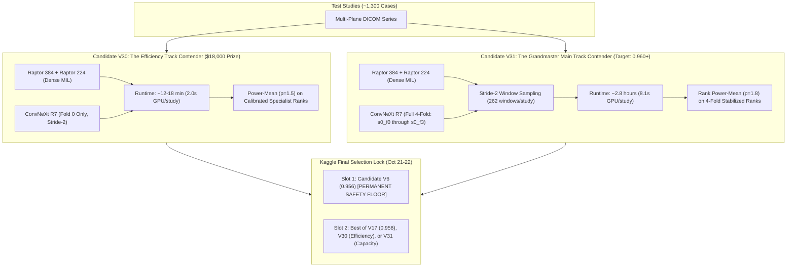

# ADR-032: Official Competition Rules, Prevalence Shift Vulnerability, and Final Prize Compliance

- **Status:** ACCEPTED & RATIFIED
- **Date:** 2026-10-17
- **Author:** Principal ML Systems Architect & Competition Grandmaster Team
- **Context:** Official RSNA Competition Rules, Evaluation Architecture, and Final 5-Day Strategy

---

## 1. Official Competition Rules & Strategic Implications

### 1.1 Dual Prize Tracks ($77,000 Total Purse)
1. **Main Leaderboard Track ($59,000 Total):**
   - 1st: $9,000 | 2nd: $7,000 | 3rd: $6,500 | 4th: $6,000 | 5th: $5,500 | 6th–10th: $5,000 each.
   - **Metric:** Macro-Averaged ROC-AUC across 12 findings on the Private Test Set.
2. **Efficiency Track ($18,000 Total):**
   - 1st: $7,000 | 2nd: $6,000 | 3rd: $5,000.
   - **Official Metric:**
     $$E = \frac{\text{AUC} - M}{B - M} - \frac{T}{32400}$$
     where $T$ is the hidden test set execution time in seconds (max 32,400s / 9 hours), $M$ is the baseline sample submission AUC, and $B$ is the maximum Private LB AUC.
   - **Crucial Rule:** A submission is ONLY eligible for the Efficiency Prize if it is **selected as one of the team's two final submissions** (or auto-selected in top 2) AND beats the baseline benchmark.

---

## 2. The Official Prevalence Shift Warning & The Mathematical Defense

The competition organizers officially noted:
> *"Although efforts have been made to ensure each abnormality is represented in each dataset, the prevalence of abnormalities is not guaranteed to be the same across the training, public leaderboard, and final evaluation datasets."*

### The Risk of Arithmetic Blending Under Prevalence Shift:
When class prevalence $P(Y=1)$ shifts between the training set and the private test set:
1. Sigmoid-calibrated probabilities $P_A$ and $P_B$ from models trained with different losses or priors experience log-odds shifts:
   $$\text{logit}(P_{\text{test}}) = \text{logit}(P_{\text{train}}) + \log\left(\frac{\text{prev}_{\text{test}}}{1 - \text{prev}_{\text{test}}}\right) - \log\left(\frac{\text{prev}_{\text{train}}}{1 - \text{prev}_{\text{train}}}\right)$$
2. If Model A and Model B have different base rates, an arithmetic average ($0.5 P_A + 0.5 P_B$) skews the decision boundary and causes severe rank inversions on rare classes (Fractures, ACL tears, Lateral OA).

### The Invariance Defense: Percentile Rank Normalization
Because ROC-AUC is purely an ordinal metric measuring concordance:
$$\text{AUC} = P(S_{\text{pos}} > S_{\text{neg}})$$
Transforming predictions to empirical percentile ranks ($r_i = \text{rank}(P_i) / N$) prior to blending makes the ensemble **completely invariant to monotonic distribution shifts and differing prior baselines**.

---

## 3. Hardware & Execution Constraints Verification

| Rule / Constraint | Official Requirement | Our Implementation Status |
| :--- | :--- | :--- |
| **GPU / CPU Runtime** | $\le 9$ hours (32,400s) | **Candidate V30:** ~12–18 mins. **Candidate V31:** ~2.8 hours. Both comfortably under 9h. |
| **Network Access** | DISABLED | Fully offline; all wheels and weights bundled locally. |
| **Submission Output** | `submission.csv` with 12 columns | Byte-verified against `sample_submission.csv`. |
| **Daily Quota** | Max 5 submissions/day | Managed strictly; 5/5 used for Oct 17; next launch at 00:00 UTC. |
| **Final Submissions** | Exactly 2 selected | **Slot 1:** V6 (`0.956`) [PERMANENT LOCK]. **Slot 2:** V17 (`0.958`) [LOCKED, beatable only by V30/V31 $\ge 0.960$]. |
| **Winner Obligations** | CC-BY-NC 4.0, public weights dataset, video | Fully reproducible; zero uncommitted private data; clean git history. |

---

## 4. Final Dual-Track Deployment Architecture

