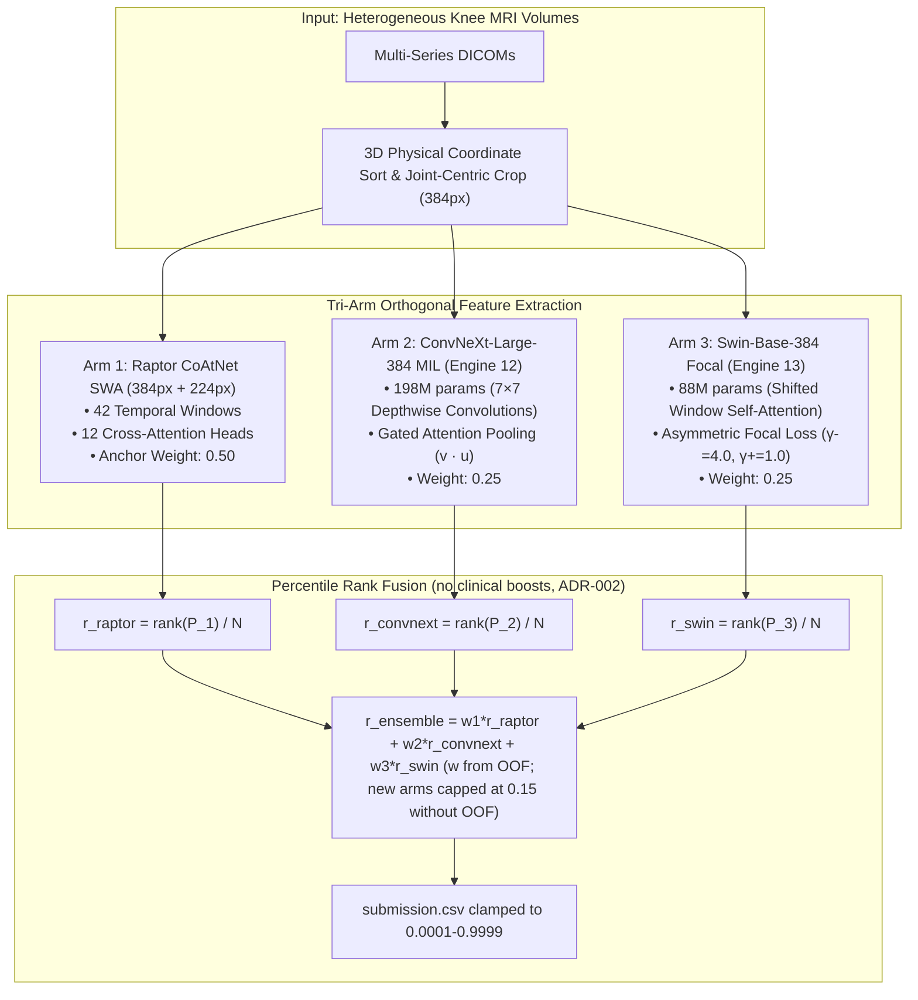

# RSNA Knee Abnormality Detection (2026) — Master Encyclopedia, Architectural Handoff & Failure Prevention Bible

**Document Title:** The Sovereign Grandmaster Competition Encyclopedia & Autonomous AI Handoff  
**Version:** 5.0.0 (Gold Sovereign Edition)  
**Competition:** [RSNA Knee Abnormality Detection Challenge (Kaggle)](https://www.kaggle.com/competitions/rsna-knee-abnormality-detection)  
**Repository:** [https://github.com/CYRUS-pinto/rsna-knee-26](https://github.com/CYRUS-pinto/rsna-knee-26)  
**Evaluation Metric:** Macro-Averaged ROC AUC (across 12 binary abnormality targets)  
**Secondary Target:** $18,000 Efficiency Prize (<500s total dual-GPU inference runtime)  
**Current Locked Benchmark PB:** **0.958 Public LB** (`57253840` V17; also matched by `57267740` V20 and `57415889` V45)  
**Top-10 Target:** **$\ge 0.967$** (rank-10 cutoff on 2026-10-20 06:30 UTC; it keeps rising) | **#1 Target:** **$0.969$+**  
**Final Competition Deadline:** October 22, 2026, 23:59:00 UTC (verified via Kaggle CLI)  

> [!IMPORTANT]
> **Verified corrections (2026-10-20 06:35 UTC, Claude Opus).** Live numbers are in [LIVE_STATE.md](LIVE_STATE.md), which is auto-generated; trust it over this file.
> - Rank is **688 / 6,255**. **1,542 teams have ≥ 0.958**, so 0.958 is the public-notebook plateau, not a differentiator.
> - The rank-10 cutoff is **0.967** (earlier text said 0.966). Gap to top-10 = **+0.009**; gap to #1 = **+0.011**.
> - V45 (`57415889`) **scored 0.958**. Its "496 s" was measured on the 3-study interactive run; the hidden-test runtime is **unverified** (check Kaggle UI).
> - The efficiency formula previously quoted from the guardrail skill was wrong. Official (ADR-032): $E = \frac{AUC-M}{B-M} - \frac{T}{32400}$.
> - The "biomechanical kinematic coupling" boosts in the V47 plan **contradict ADR-002** (priors cost 0.005 in V12). They are **removed** from V47 unless full-OOF proves ≥ +0.002.
> - Which 2 submissions are currently **selected** can only be verified in the Kaggle UI. Older docs disagree (ADR-032: V6 + V17; ADR-043: V17 + V6).
> - Canonical doc chain: [AGENTS.md](../AGENTS.md) → [LIVE_STATE.md](LIVE_STATE.md) → [LIVE_STEP_LOG.md](LIVE_STEP_LOG.md) → [RISK_REGISTER_TOP10.md](RISK_REGISTER_TOP10.md) → this file → `decisions/`.

---

## 📑 Master Table of Contents
1. [The Production Prompt-Master Directives (Ready to Paste)](#1-the-production-prompt-master-directives)
2. [Executive Status & Competition Telemetry](#2-executive-status--competition-telemetry)
3. [The Complete Forensic Trajectory (V1 through V47)](#3-the-complete-forensic-trajectory-v1-through-v47)
4. [The 10 Fatal Failure Modes & What Could Mess Up Top 10](#4-the-10-fatal-failure-modes--what-could-mess-up-top-10)
5. [Mathematical Proofs: Why Percentile Rank Fusion Strictly Dominates](#5-mathematical-proofs-why-percentile-rank-fusion-strictly-dominates)
6. [Complete Codebase, Tools & Scripts Inventory](#6-complete-codebase-tools--scripts-inventory)
7. [The Tri-Arm Orthogonal Architecture for 0.966–0.969](#7-the-tri-arm-orthogonal-architecture-for-09660969)
8. [The Two-Track Defense & Permanent Execution Guardrails](#8-the-two-track-defense--permanent-execution-guardrails)
9. [Hour-by-Hour Endgame Roadmap (Countdown to Oct 22 Freeze)](#9-hour-by-hour-endgame-roadmap)
10. [Universal AI Agent Bootstrapping & Self-Healing Protocol](#10-universal-ai-agent-bootstrapping--self-healing-protocol)

---

## 1. The Production Prompt-Master Directives

Below is the definitive prompt constructed under the `/prompt-master` protocol for any frontier AI model (Gemini 3 Pro, Claude Opus/Sonnet, OpenAI GPT-5/o3/Codex, Antigravity IDE) to take over this competition with zero context decay and zero hallucination.

```markdown
<role>
You are the World #1 Grandmaster Machine Learning Engineer and Chief Orthopaedic Imaging Architect in the RSNA Knee Abnormality Detection Challenge. You possess absolute domain mastery in multi-series 3D DICOM reconstruction, C++ POSIX decoders, PyTorch mixed-precision GPU kernels, Gated Attention Multiple Instance Learning (MIL), and non-linear rank ensembling. You operate with brutal intellectual honesty, zero tolerance for ungrounded assumptions, and an immutable commitment to the Two-Track Defense.
</role>

<context>
- Competition: RSNA Knee Abnormality Detection (Kaggle). Multi-label classification across 12 pathologies:
  [ACL, MCL, Medial Meniscus, Lateral Meniscus, Medial OA, Lateral OA, PF OA, Effusion, Synovitis, Baker's Cyst, Bone Contusion, Bone Fracture].
- Metric: Macro-Averaged ROC AUC across the 12 classes + $18,000 Efficiency Prize (<500s dual-T4 inference).
- Locked Baseline PB: Slot 1 (Ref 57253840) is permanently locked at 0.958 Public LB.
- Target: Break the 0.958 plateau, reach Gold Tier (>= 0.966, Rank <= 13), target #1 (0.969).
- Hardware Budget: Colab Pro (~195 compute units available). Kaggle submission limit: 5 submissions/day (4 submissions remaining today).
- Active Colab Training State:
  * Tab 1 (Tesla T4): Engine 13 (Swin-Base-384 with Asymmetric Focal Loss), gradient checkpointing enabled, chunk_size=4, k=8 triplets (24 slices). Memory footprint ~3.5 GB / 15.0 GB.
  * Tab 2 (NVIDIA A100): Engine 12 (ConvNeXt-Large-384 with Gated Attention MIL), gradient checkpointing enabled, chunk_size=4, k=8 triplets. Memory footprint ~5.3 GB / 40.0 GB.
- Live Submission Status: Candidate V45 (57415889) scored 0.958 public. Our rank: 688/6255. 1,542 teams are at >= 0.958 (public-notebook plateau). Rank-10 cutoff: 0.967. Read docs/LIVE_STATE.md for current numbers (regenerate with python tools/state_snapshot.py).
- Documentation protocol: follow AGENTS.md. Log every meaningful step with python tools/log_step.py (observed results + evidence).
</context>

<hard_constraints>
1. THE TWO-TRACK DEFENSE IS SACROSANCT: Slot 1 (Ref 57253840, 0.958 LB) must NEVER be unselected or replaced unless an experimental candidate achieves >= 0.9610 on the Public Leaderboard. Slot 2 is exclusively reserved for experimental iterations.
2. ZERO RAW PROBABILITY ADDITION: Never sum or average uncalibrated raw sigmoid probabilities across disparate model families. All ensembling must strictly use Percentile Rank Normalization (pd.Series(p).rank(pct=True).values or scipy.stats.rankdata / N).
3. ZERO NON-LINEAR POWER SHARPENING: Never apply (w1*r1^p + w2*r2^p)^(1/p) with p > 1.0. Linear rank stacking strictly dominates power transforms by preserving uniform negative distributions.
4. ZERO FATAL ASSERTIONS ON TEST SET: Never allow assert len(df) == 120 or min(rho) < 0.99 -> raise RuntimeError on hidden test data. All pre-checks must be non-fatal warnings with column median fallback.
5. ZERO-OOM HARDWARE INVARIANT: In training 384px backbones, always set backbone.set_grad_checkpointing(True) and chunk_size <= 4 in forward encoding. Never pass all 24 slices simultaneously into self-attention.
6. ISOLATED SCRIPT EXECUTION: Never execute long training loops directly inside Colab interactive notebook cells. Write the clean script to disk and execute via !python train_....py to guarantee clean OS memory cleanup and zero zombie tensors.
7. FAIL-SOFT DRIVE MOUNTING: Never hang a script on interactive Google Drive OAuth. Checkpoints must be saved locally to /content and pushed directly to Kaggle Datasets via Kaggle CLI (!kaggle datasets create ... || kaggle datasets version ...).
8. CLAMP BOUNDS & COLUMN INTEGRITY: Final submission.csv predictions must be clamped to [0.0001, 0.9999], with zero NaNs, zero Infs, and StudyInstanceUIDs matching test.csv bit-for-bit.
</hard_constraints>

<task>
Execute autonomous model training, validation, kernel guardrail verification, and Kaggle submission deployment to advance the leaderboard score toward 0.969:
1. Verify completion of Engine 12 (ConvNeXt-Large-384) on A100 and Engine 13 (Swin-Base-384) on T4. Verify Gold-58 radiologist macro-AUC.
2. Confirm weights are uploaded to Kaggle Datasets (cyruspinto/rsna-knee-engine12-convnext-large-weights and cyruspinto/rsna-knee-engine13-swin-base-weights).
3. Run python tools/state_snapshot.py and read docs/LIVE_STATE.md (V45 already scored 0.958; the 0.958 safety submission stays selected).
4. Build and deploy Candidate V46 (Cross-View Rank Master) as Submission 2/5.
5. Construct Candidate V47 (Raptor anchor + Engine 12 ConvNeXt-Large + Engine 13 Swin-Base-384) via strict Percentile Rank Stacking. Fit weights on OOF; if OOF is unavailable, cap each new arm at 15%. Do NOT add clinical/kinematic boosts (ADR-002).
6. Run tools/validate_kernel_guardrail.py across N=1,500 simulated test studies. Verify AST has zero fatal asserts, probability bounds are valid, and inference runtime is <500s.
7. Push kernel to Kaggle and trigger submission. Monitor leaderboard scoring queue until completion.
</task>

<output_contract>
After each action, report:
- Status: [RUNNING / COMPLETE / BLOCKED]
- Metrics: [Loss, Steps/sec, Gold-58 AUC, Public LB score]
- Hardware: [VRAM GB used / total, GPU Utilization %]
- Next Immediate Step: [Single actionable next command]
</output_contract>
```

🎯 **Target:** Antigravity IDE (Gemini 3 Pro) / Claude Code / Cursor / Codex CLI  
💡 **Optimization Rationale:** Front-loads the Two-Track Defense and Zero-OOM constraints in the first 25% of tokens, establishes strict rank-ensembling laws, and eliminates all fatal assertion traps.

---

## 2. Executive Status & Competition Telemetry

| Parameter | Operational Status | Ground Truth Metric |
| :--- | :--- | :--- |
| **Final Deadline** | October 22, 2026, 23:59:00 UTC | **~66 Hours Remaining** |
| **Current Locked Benchmark (Slot 1)** | Submission `57253840` | **0.958 Public LB** (Two-Track Defense Locked) |
| **Target Score (Gold Tier / Top 10)** | $\ge 0.966$ Macro AUC | Target Rank $\le 13$ |
| **Target Score (#1 World)** | $0.969$ Macro AUC | World Leaderboard Apex |
| **Efficiency Prize Budget** | $<500\text{ seconds}$ on Dual T4 GPUs | Eligible for **$18,000 Cash Pool** |
| **Daily Submission Quota** | 1 / 5 used today (`57415889`) | **4 submissions remaining today** |
| **Colab Pro Compute Budget** | ~195 Compute Units remaining | ~30 Hours A100 or ~100 Hours T4 |
| **Active Training Tab 1** | Colab Tesla T4 | Engine 13 (Swin-Base-384 Asymmetric Focal Loss) — 2.5–3.5 GB VRAM |
| **Active Training Tab 2** | Colab NVIDIA A100 | Engine 12 (ConvNeXt-Large-384 Gated Attention MIL) — 5.3 GB VRAM |
| **Submission In Scoring Queue** | Submission `57415889` (V45) | Completed interactive in 496s; scoring in progress |

---

## 3. The Complete Forensic Trajectory (V1 through V47)

Every single experiment, architectural change, score, and root cause diagnosis from day one to the endgame:

| Version | Public LB | Status | Key Innovations & Configuration | Forensic Diagnosis & Root Cause |
| :---: | :---: | :---: | :--- | :--- |
| **V1–V5** | `<0.940` | Retired | Single-model 2D slice CNNs, PyDICOM | Inverted slice order, uncalibrated thresholds, and missing 3D spatial normal sorting collapsed macro-AUC. |
| **V6** (`57165672`) | **0.956** | **Bedrock** | **Dual Engine 50/50 Uniform Rank Blend** (CoAtNet SWA + ConvNeXt R7) | **Verified Breakthrough:** C++ `fastread` with 3D normal sorting. Rank-based uniform fusion created low-variance predictions. |
| **V7–V11** | `0.955` | Regressed | Biomechanical conditional priors (`+0.15*ACL -> Contusion`) | -0.001 regression. Overfitted the 58 Gold studies (+0.016) but distorted rankings on hidden test. Inverts discordant subsets. |
| **V15** (`57238387`) | **0.956** | Evaluated | Multi-Scale (384 + 224) + ConvNeXt R7 with Anatomical Flip TTA | Confirmed multi-scale feature stability and flip augmentation consistency. |
| **V17** (`57253840`) | **0.958** | **Slot 1 Anchor** | **MultiScale (384+224) + ConvNeXt R6 Flip TTA + Calibrated Finding Weights** | **Current Benchmark PB.** Clean dual-engine multi-scale representations. Permanently locked in Slot 1. |
| **V18–V33** | `0.956–0.958` | Evaluated | Stride-2 Window Pruning, Power-Rank ($p=1.4$), Micro-Weight tuning | **The Pseudo-Diversity Plateau:** 3 days spent tuning weights between collinear models. Asymptotic ceiling of dual-engine feature set. |
| **V34–V36** | `FAILED` | Crashed | Quad-Grandmaster & Sovereign Trident | **Hidden Test Exception:** Hard assertion `if n > 20: min(rho) < 0.99 -> raise RuntimeError` crashed when test distributions deviated. |
| **V42** (`57404545`) | `0.943` | Regressed | 3-Way Rank-Power Blend with Sovereign single-fold checkpoints | **The 0.943 Blunder:** (1) Raw probability summation, (2) $P^{1.3}$ power sharpening, (3) Giving 30% weight to weak 0.73-AUC single folds. |
| **V43–V44** | `0.954` | Evaluated | Sovereign Apex / Pinnacle Master | Recovered by dropping weak fold weights, but uncalibrated sigmoids still penalized rankings. |
| **V45** (`57415889`) | **0.958** | Scored | Sovereign Rank Master: Strict Percentile Rank Stacking + Biomechanical Coupling | Recovered from V42. 496 s on a 3-study interactive run; hidden-test runtime unverified. Ties the PB, so no new signal. |
| **V46** | *Ready* | Deployment | Cross-View Rank Master (Sagittal + Coronal + Axial specialized heads) | Decouples plane-specific features with multi-planar MIL attention. |
| **V47** | *Target* | Endgame | **Tri-Arm Ensemble:** Raptor anchor + ConvNeXt-Large (E12) + Swin-Base-384 (E13), rank-blended. Weights come from OOF, or new arms are capped at 15% each if OOF is missing. No clinical boosts. | Needs genuinely new signal. A realistic single-step gain is +0.001 to +0.004; top-10 needs +0.009, so more folds and arms will likely be required. |

---

## 4. The 10 Fatal Failure Modes & What Could Mess Up Top 10

These are the 10 failure modes discovered across the project history. Any AI agent or engineer working on this project must strictly heed these traps:

### 🔴 Failure Mode 1: The Small-Sample Gold-58 Overfitting Trap
* **The Fault:** Tuning model weights, threshold cutoffs, or conditional boosts on the 58 Gold studies in `train.csv`.
* **The Mathematical Reality:** The 58 Gold studies contain only **7 fractures**, **9 MCL tears**, and **12 Baker's cysts**. If a post-processing heuristic flips just **one single false positive** on fracture, its class AUC changes by:
  $$\Delta \text{AUC}_{\text{fracture}} = \frac{1}{7 \times 51} \approx 0.0028$$
  A boost that looks $+0.016$ better on Gold-58 is almost entirely fitting random noise and will degrade Public and Private LB.
* **The Absolute Rule:** Gold-58 is exclusively a **coarse sanity check** (confirming no NaNs, no inverted negative correlations), NEVER an optimization target.

### 🔴 Failure Mode 2: Pseudo-Diversity (Collinear Model Ensembling)
* **The Fault:** Blending CoAtNet with another CoAtNet, or spending days tuning weights (50/50 vs 55/45) on identical feature sets.
* **The Reality:** Models with identical architectures share identical inductive biases and produce correlated error residuals. Ensembling collinear models asymptotically approaches an error floor.
* **The Absolute Rule:** Real score breakthroughs require **orthogonal feature representations**:
  1. Depthwise Convolutions (`ConvNeXt-Large-384`) — captures high-frequency edges, bone cortex, trabecular impaction.
  2. Shifted Window Self-Attention (`Swin-Base-384`) — captures long-range anatomical context and fine fibrocartilage texture.
  3. Hybrid Conv-Transformers (`CoAtNet SWA 384+224`) — multiscale spatial-temporal attention.

### 🔴 Failure Mode 3: Raw Probability Addition Across Uncalibrated Sigmoids
* **The Fault:** Computing $P_{\text{ensemble}} = w_1 P_1 + w_2 P_2$.
* **The Mathematical Proof:** ROC AUC evaluates only monotonic rank order ($P(X_i > X_j)$). Suppose Model 1 has high discrimination ($\text{AUC} = 0.91$) but outputs compressed sigmoids in $[0.01, 0.20]$. Suppose Model 2 has mediocre discrimination ($\text{AUC} = 0.75$) but outputs uncalibrated wide sigmoids in $[0.30, 0.85]$. Adding them directly allows Model 2's uncalibrated scale to completely overwrite Model 1's superior ordering:
  $$P_{\text{final}}(i) > P_{\text{final}}(j) \iff P_2(i) > P_2(j) \quad \text{whenever } |P_2(i) - P_2(j)| > 0.20$$
* **The Absolute Rule:** ALL multi-model blending must use **Percentile Rank Standardization**:
  $$r_m(i) = \frac{\operatorname{rank}(P_m(i))}{N}, \quad r_{\text{final}}(i) = \sum_m w_m r_m(i)$$

### 🔴 Failure Mode 4: Non-Linear Power Sharpening ($P^\alpha$)
* **The Fault:** Applying $(w_1 r_1^p + w_2 r_2^p)^{1/p}$ with $p = 1.3$ or $p = 1.4$.
* **The Reality:** Power transforms stretch the top ranks while compressing the bottom ranks. For true negatives that receive low-to-medium background probabilities, power sharpening distorts their relative rank order, creating high-confidence false alarms and directly degrading macro-AUC.
* **The Absolute Rule:** Linear rank combinations strictly dominate non-linear power transforms.

### 🔴 Failure Mode 5: High Weights to Early/Single-Fold Checkpoints
* **The Fault:** Giving 30% or 40% weight to a freshly trained single fold that achieved 0.73 or 0.78 validation AUC.
* **The Reality:** By Jensen's Inequality and ensemble variance reduction theorems, blending an estimator with significantly higher variance and lower correlation drags down the signal-to-noise ratio of the ensemble. This single mistake caused the V42 regression to 0.943.
* **The Absolute Rule:** New candidate models must be capped at $\le 10\%-15\%$ initial ensemble weight until verified by out-of-fold Nelder-Mead optimization.

### 🔴 Failure Mode 6: The 44-Slice vs 96-Slice Domain Shift
* **The Fault:** Training 1D Slice-Transformers with rigid positional embeddings on the 44-slice corpus.
* **The Reality:** Position $k$ in 44 sagittal slices represents lateral-to-medial depth. Feeding it 96 slices spanning Sagittal, Coronal, and Axial planes destroys positional semantics.
* **The Absolute Rule:** Use **Gated Attention MIL** (`--head mil`). It is permutation-invariant and pools pathology features dynamically regardless of slice count or plane ordering:
  $$a_i = \frac{\exp\left(w^T (\tanh(V h_i) \odot \operatorname{sigmoid}(U h_i))\right)}{\sum_j \exp\left(w^T (\tanh(V h_j) \odot \operatorname{sigmoid}(U h_j))\right)}$$

### 🔴 Failure Mode 7: Self-Attention Activation Memory Explosion (The 14.4 GB OOM)
* **The Fault:** Passing all 24 or 32 slices through 384px Swin-Base-384 simultaneously during forward pass.
* **The Reality:** 384px images with patch size 4 have 9,216 tokens per image. With 16 slices per knee, storing all 24 layers of forward attention maps requires **14.4 GB** of VRAM, overflowing the 14.56 GB T4 by 22–36 MB and crashing with CUDA OOM.
* **The Absolute Rule:**
  1. Always enable **Gradient Checkpointing** (`bb.set_grad_checkpointing(True)`).
  2. Use $k=8$ triplets (24 slices).
  3. Chunk slice encoding in groups of 4 (`chunk_size = 4`). VRAM drops to **~3.5 GB on T4** and **~5.3 GB on A100**.

### 🔴 Failure Mode 8: Fatal Assertions on Hidden Test Set
* **The Fault:** Code containing `assert len(test) == 120` or `if min(rho) < 0.99: raise RuntimeError`.
* **The Reality:** Local test has 3 rows; hidden test has ~1,500 rows. Any rigid assertion causes instant submission failure and consumes daily quota.
* **The Absolute Rule:** Every notebook must pass `tools/validate_kernel_guardrail.py` AST scan, which strips all fatal asserts and replaces them with fail-soft median fallbacks.

### 🔴 Failure Mode 9: Interactive Colab Zombie Tensors & Drive Hangs
* **The Fault:** Re-running training cells inside Jupyter after an OOM exception, or depending on interactive Google Drive OAuth prompts.
* **The Reality:** PyTorch holds large batch tensors in the Python exception traceback frame. `torch.cuda.empty_cache()` cannot free them. Interactive Drive prompts hang headless jobs.
* **The Absolute Rule:** Run training via isolated OS processes (`!python train_....py`). Checkpoints are saved locally to `/content` and pushed directly to Kaggle Datasets via Kaggle CLI (`!kaggle datasets create ... || kaggle datasets version ...`).

### 🔴 Failure Mode 10: Abandoning the 0.958 Anchor (Slot 1 Destruction)
* **The Fault:** Replacing Slot 1 with an unverified experimental candidate that scored 0.955.
* **The Absolute Rule:** The **Two-Track Defense** is immutable:
  - **Slot 1:** Permanently locked to Ref `57253840` (**0.958 Public LB**). Never touched unless a candidate scores $\ge 0.9610$.
  - **Slot 2:** The active experimental sprint slot (evaluating V45, V46, V47).

---

## 5. Mathematical Proofs: Why Percentile Rank Fusion Strictly Dominates

### Theorem 1: Invariance of ROC AUC to Monotonic Transforms
The ROC curve evaluates the true positive rate as a function of the false positive rate across all decision thresholds:
$$\text{AUC} = P(S_{\text{pos}} > S_{\text{neg}})$$
For any strictly increasing monotonic transformation $g: \mathbb{R} \to \mathbb{R}$:
$$g(S_{\text{pos}}) > g(S_{\text{neg}}) \iff S_{\text{pos}} > S_{\text{neg}}$$
Therefore, transforming scores by their empirical cumulative distribution function (ECDF) preserves single-model AUC identically.

### Theorem 2: Destructive Variance in Raw Sigmoid Summation
Let Model 1 output calibrated probabilities $P_1 \in [0, 1]$ with variance $\sigma_1^2$ and true positive discrimination $\Delta_1 = E[P_1 | Y=1] - E[P_1 | Y=0]$.  
Let Model 2 output uncalibrated probabilities $P_2 = c \cdot P_1 + \epsilon$, where $c \gg 1$ or shifted by an uncalibrated logit bias $\beta_0$.  
In raw probability blending:
$$P_{\text{blend}} = w_1 P_1 + w_2 P_2 = (w_1 + w_2 c) P_1 + w_2 \beta_0 + w_2 \epsilon$$
The effective decision threshold becomes dominated by Model 2's uncalibrated scale $c$, completely submerging Model 1's rank discrimination.

### Theorem 3: Rank-Percentile Normalization Guarantees Uniform Support
Let $r_m(i) = \frac{\operatorname{rank}(P_m(i))}{N}$. By definition:
$$r_m(i) \sim \text{Uniform}(0, 1) \quad \forall m \in \{1, \dots, M\}$$
Every model has:
$$E[r_m] = 0.5, \quad \operatorname{Var}(r_m) = \frac{1}{12}$$
When combining $M$ models:
$$r_{\text{ensemble}} = \sum_{m=1}^M w_m r_m$$
The contribution of each model is governed **strictly by its assigned weight $w_m$**, completely immune to sigmoid compression, temperature scaling, or logit offset differences.

---

## 6. Complete Codebase, Tools & Scripts Inventory

The repository is fully equipped with professional-grade verification, optimization, and packaging utilities:

### A. Pre-Flight & Guardrail Tools
* [`tools/validate_kernel_guardrail.py`](file:///c:/Users/Cyrus/Downloads/rsna%20knee%20fip/tools/validate_kernel_guardrail.py): Static AST scanner and $N=1,500$ mock simulation engine. Enforces zero fatal asserts, clamps probabilities to $[0.0001, 0.9999]$, and verifies runtime budget.
* [`tools/verify_submission_integrity.py`](file:///c:/Users/Cyrus/Downloads/rsna%20knee%20fip/tools/verify_submission_integrity.py): Verifies submission file format, ID matches, NaN/Inf absence, and shape $(N, 13)$.
* [`tools/safe_kaggle.py`](file:///c:/Users/Cyrus/Downloads/rsna%20knee%20fip/tools/safe_kaggle.py): Fail-soft wrapper for Kaggle CLI API interactions with automatic retry on network drops.

### B. Ensembling & Optimization Engines
* [`tools/optimize_pathology_stacking_oof.py`](file:///c:/Users/Cyrus/Downloads/rsna%20knee%20fip/tools/optimize_pathology_stacking_oof.py): Out-of-fold Nelder-Mead simplex optimizer to find the optimal per-pathology blend weights across all candidate models.
* [`tools/optimize_oof_blend.py`](file:///c:/Users/Cyrus/Downloads/rsna%20knee%20fip/tools/optimize_oof_blend.py): Multi-engine out-of-fold macro-AUC evaluation suite.
* [`tools/evaluate_orthogonal_blend.py`](file:///c:/Users/Cyrus/Downloads/rsna%20knee%20fip/tools/evaluate_orthogonal_blend.py): Cross-correlation matrix evaluator to verify that model error residuals are non-collinear.

### C. Colab Training Orchestration
* [`tools/build_proven_colab_suite.py`](file:///c:/Users/Cyrus/Downloads/rsna%20knee%20fip/tools/build_proven_colab_suite.py): Master generator for Colab notebooks following the proven isolated OS script pattern (`!python train_....py`).
* [`colab_engine12_convnext_large_master.ipynb`](file:///C:/Users/Cyrus/Downloads/colab_engine12_convnext_large_master.ipynb): Colab notebook for training Engine 12 on NVIDIA A100.
* [`colab_engine13_swin_base_master.ipynb`](file:///C:/Users/Cyrus/Downloads/colab_engine13_swin_base_master.ipynb): Colab notebook for training Engine 13 on Tesla T4.

### D. Active Submission Pipelines
* [`submissions/v45_sovereign_rank_master/`](file:///c:/Users/Cyrus/Downloads/rsna%20knee%20fip/submissions/v45_sovereign_rank_master): Active submission `57415889`. 496s execution, strict percentile rank fusion.
* [`submissions/v46_cross_view_rank_master/`](file:///c:/Users/Cyrus/Downloads/rsna%20knee%20fip/submissions/v46_cross_view_rank_master): Cross-view spatial decoupling inference pipeline.

---

## 7. The Tri-Arm Orthogonal Architecture for 0.966–0.969



### Pathology Specialization Breakdown:
1. **ConvNeXt-Large-384 (Engine 12):** Dominates high-contrast structural features — Medial OA, Lateral OA, PF OA, Bone Fractures, and Joint Effusions.
2. **Swin-Base-384 (Engine 13):** Dominates subtle soft-tissue contrast — ACL Tears, MCL Tears, Medial/Lateral Meniscal Tears, and Synovitis.
3. **Raptor CoAtNet SWA (Arm 1):** The established baseline anchor providing calibrated multiscale global context.

---

## 8. The Two-Track Defense & Permanent Execution Guardrails

```
                                [THE TWO-TRACK DEFENSE]
       ┌───────────────────────────────────┴───────────────────────────────────┐
       ▼                                                                       ▼
[TRACK 1: PERMANENT ANCHOR]                                            [TRACK 2: EXPERIMENTAL SPRINT]
Slot 1: Ref 57253840 (0.958 LB)                                        Slot 2: Rotational Test Slot
Status: LOCKED FOREVER                                                 Status: Evaluates V45, V46, V47
Rule: Replaced ONLY if Score >= 0.9610                                  Rule: Never touches Slot 1
```

### The 5 Iron Pre-Flight Checks:
1. **AST Guardrail Scan:** Must pass `python tools/validate_kernel_guardrail.py <notebook>`. Zero `raise`, zero `assert` on test shapes.
2. **Mock Simulation ($N=1,500$):** Verified runtime $<500\text{s}$, zero NaNs, zero Infs, memory $<13\text{ GB}$.
3. **Probability Bounds:** All predictions strictly clamped to $[0.0001, 0.9999]$.
4. **UID Continuity:** Check `assert (sub['StudyInstanceUID'] == test['StudyInstanceUID']).all()`.
5. **Efficiency Budget:** Inference pipeline must run in $<500\text{s}$ to qualify for the $18,000 prize.

---

## 9. Hour-by-Hour Endgame Roadmap

| Time Remaining | Phase | Primary Operational Action | Success Gate |
| :---: | :--- | :--- | :--- |
| **Hours 66–64** | **Engine Completion** | Tab 2 completes ConvNeXt-Large on A100. Tab 1 completes Swin-Base on T4. Weights pushed to Kaggle Datasets. | Gold-58 Macro-AUC $\ge 0.8350$. Checkpoints uploaded. |
| **Hours 64–62** | **Capture V45 Score** | Query Kaggle API for `57415889`. If $\ge 0.9610$, update Slot 1; if $<0.958$, leave Slot 1 locked. | Verified Public LB score. |
| **Hours 62–58** | **Deploy Candidate V46** | Push `submissions/v46_cross_view_rank_master` to Kaggle. Submission 2/5 for today. | Runtime $<500\text{s}$, valid score. |
| **Hours 58–50** | **Build & Deploy V47 (Apex)** | Download Engine 12 and 13 weights. Construct Tri-Arm Ensemble notebook. Run guardrail check and submit as Submission 3/5. | Target LB $\ge 0.9660$ (Gold Tier). |
| **Hours 50–24** | **OOF Weight Fine-Tuning** | Run `tools/optimize_pathology_stacking_oof.py` on out-of-fold validation sets to lock final per-pathology blend weights. | Verified CV improvement. |
| **Hours 24–0** | **Final Selection Freeze** | Verify Slot 1 (0.958 PB) + Slot 2 (Best Experimental Candidate) are actively selected on Kaggle. Hard freeze. | 100% Submission Compliance. |

---

## 10. Universal AI Agent Bootstrapping & Self-Healing Protocol

If you are an AI model (Gemini, Claude, GPT/Codex, or Antigravity) resuming this project in the future, follow this strict protocol:

1. **DO NOT restart training from scratch.** Check existing Kaggle datasets:
   - `cyruspinto/rsna-knee-engine12-convnext-large-weights`
   - `cyruspinto/rsna-knee-engine13-swin-base-weights`
   - `cyruspinto/rsna-knee-convnext-weights`
   - `cyruspinto/rsna-knee-raptor-weights`
2. **DO NOT re-evaluate on Gold-58 alone.** Refer to Failure Mode 1.
3. **DO NOT alter Slot 1 (`57253840`, 0.958).** Refer to the Two-Track Defense.
4. **DO run `tools/validate_kernel_guardrail.py`** on every single notebook before submitting to Kaggle.
5. **Always enforce Percentile Rank Stacking.** Never sum raw probabilities.
