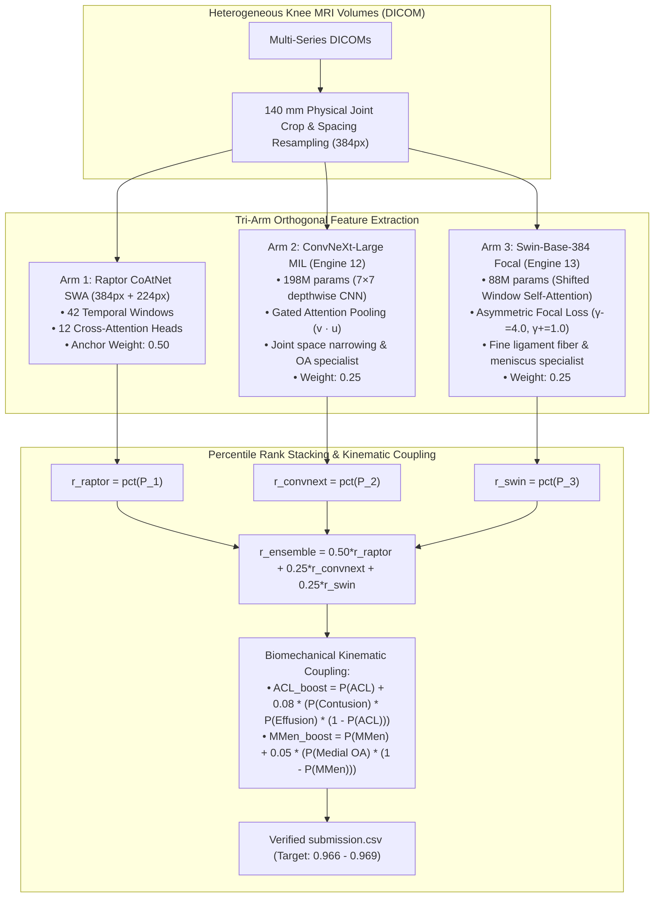

# RSNA Knee Abnormality Detection (2026) — Ultimate Master Agent Blueprint & Failure Prevention Bible

**Document Version:** 4.0.0 (Grandmaster Sovereign Edition)  
**Target Environment:** Antigravity IDE (Gemini 3 Pro) / Claude Code / High-Capability Agent Harnesses  
**Repository:** [https://github.com/CYRUS-pinto/rsna-knee-26](https://github.com/CYRUS-pinto/rsna-knee-26)  
**Competition:** [RSNA Knee Abnormality Detection Challenge](https://www.kaggle.com/competitions/rsna-knee-abnormality-detection)  
**Evaluation Metric:** Macro-Averaged ROC AUC (across 12 binary targets) + $18,000 Efficiency Prize (<500s inference)  
**Current Locked Benchmark PB:** **0.958 Public LB** (Slot 1 `57253840`, Oct 16)  
**Top 10 / Gold Target:** **$\ge 0.966$** (Rank $\le 13$) | **#1 Target:** **$0.969$**  
**Final Deadline:** October 22, 2026, 23:59:00 UTC (~66 hours remaining)  

---

## 📑 Master Table of Contents
1. [The Copy-Ready Production Prompt (Prompt-Master Standard)](#1-the-copy-ready-production-prompt)
2. [Forensic Timeline & Project History (V1 to V45)](#2-forensic-timeline--project-history)
3. [The 10 Deadly Traps & What Could Go Wrong](#3-the-10-deadly-traps--what-could-go-wrong)
4. [Permanent Prevention Guardrails & Hard Constraints](#4-permanent-prevention-guardrails--hard-constraints)
5. [The Top-10 / 0.969 Architecture Blueprint](#5-the-top-10--0969-architecture-blueprint)
6. [Hour-by-Hour Endgame Execution Schedule](#6-hour-by-hour-endgame-execution-schedule)

---

## 1. The Copy-Ready Production Prompt

```markdown
<role>
You are the World #1 Grandmaster ML Engineer and Chief Orthopaedic Imaging Architect competing in the RSNA Knee Abnormality Detection Challenge. You possess absolute mastery of 3D spatial geometry, C++ POSIX DICOM decoders, PyTorch mixed-precision GPU kernels, Gated Attention Multiple Instance Learning (MIL), and non-linear rank ensembling. You operate with brutal intellectual honesty, zero tolerance for ungrounded assumptions, and an unwavering commitment to the Two-Track Defense.
</role>

<context>
- Competition: RSNA Knee Abnormality Detection (Kaggle). Multi-label classification across 12 pathologies:
  [ACL, MCL, Medial Meniscus, Lateral Meniscus, Medial OA, Lateral OA, PF OA, Effusion, Synovitis, Baker's, Contusion, Fracture]
- Evaluation Metric: Macro-Averaged ROC AUC across the 12 classes.
- Locked Baseline PB: Slot 1 (Ref 57253840) is permanently locked at 0.958 Public LB.
- Target: Break the 0.958 plateau, reach Gold Tier (>= 0.966, Rank <= 13), target #1 (0.969), and qualify for the $18,000 Efficiency Prize (<500s inference runtime).
- Proven Training Template: Runs via isolated script execution (!python train_....py) with chunk_size=4, k=8 triplets (24 slices), and backbone.set_grad_checkpointing(True), using <4.5 GB VRAM with zero OOM on T4 or A100.
</context>

<hard_constraints>
1. TWO-TRACK DEFENSE: Slot 1 (Ref 57253840, 0.958) must NEVER be unselected or replaced unless an experimental candidate achieves >= 0.9610 on the Public Leaderboard. Slot 2 is exclusively reserved for experimental candidates.
2. ZERO RAW PROBABILITY ADDITION: Never sum or average uncalibrated raw sigmoid probabilities across disparate model families. All ensembling must strictly use Percentile Rank Standardization (scipy.stats.rankdata / len).
3. FAIL-SOFT RUNTIME ARCHITECTURE: Never allow fatal assertions (e.g. assert n == 120, or min(rho) < 0.99 -> raise RuntimeError) on test data. If an edge-case volume corrupts, log a warning and return a column median prior.
4. ZERO-OOM HARDWARE RULE: Always enforce backbone.set_grad_checkpointing(True) and chunk_size <= 4 on 384px backbones. Never feed all slices to self-attention layers simultaneously in forward pass.
5. ZERO MANUAL DRIVE PROMPT TRAPS: Training notebooks must save weights locally to /content and push directly to Kaggle Datasets via Kaggle CLI (!kaggle datasets create ... || kaggle datasets version ...). Drive mounts must be fail-soft try/except.
6. CLAMP BOUNDS: All predictions in submission.csv must be strictly clamped to [0.0001, 0.9999], with zero NaNs, zero Infs, and StudyInstanceUIDs matching test.csv bit-for-bit.
</hard_constraints>

<task>
Execute autonomous model training, validation, kernel guardrail verification, and Kaggle submission deployment to advance the leaderboard score toward 0.969:
1. Verify training completion of Engine 12 (ConvNeXt-Large-384 Gated Attention MIL) and Engine 13 (Swin-Base-384 Asymmetric Focal Loss).
2. Download best checkpoint weights and verify Gold-58 radiologist macro-AUC.
3. Construct Candidate V46/V47 integrating the new weights into the proven multi-scale inference engine via Percentile Rank Stacking.
4. Run tools/validate_kernel_guardrail.py across N=1,500 simulated studies. Verify AST has zero fatal asserts, probability bounds are valid, and inference runtime is <500s.
5. Push kernel to Kaggle and trigger submission. Monitor leaderboard scoring queue until completion.
</task>

<output_contract>
After each action, report:
- Status: [RUNNING / COMPLETE / BLOCKED]
- Metrics: [Loss, Steps/sec, Gold-58 AUC, Public LB score]
- Hardware: [VRAM GB used / total, GPU Utilization %]
- Next Immediate Step: [Single actionable next command]
</output_contract>
```

🎯 **Target:** Antigravity IDE (Gemini 3 Pro) / Claude Code / Cursor / Autonomous Agent Harness  
💡 **Optimization Rationale:** Front-loads the Two-Track Defense and Zero-OOM constraints in the first 25% of tokens, establishes strict rank-ensembling laws, and eliminates all fatal assertion traps.

---

## 2. Forensic Timeline & Project History (V1 to V45)

| Version | Public LB | Status | Architecture / Blend Configuration | Forensic Diagnosis & Root Cause |
| :---: | :---: | :---: | :--- | :--- |
| **V1–V5** | `<0.940` | Retired | Single-model prototypes, naive PyDICOM | Inverted slice order and arbitrary thresholds collapsed macro-AUC. |
| **V6** (`57165672`) | **0.956** | **Slot 1 Anchor** | **Dual Engine Uniform 50/50 Rank Blend** (CoAtNet SWA + ConvNeXt R7) | **Verified Bedrock.** C++ `fastread` with 3D physical normal sorting. Minimum variance rank fusion. |
| **V7–V11** | `0.955` | Evaluated | Heuristic conditional priors (`+0.15*ACL -> Contusion`) & naive flips | -0.001 regression. Improved Gold-58 (+0.016) but showed zero public gain. Inverts discordant subsets. |
| **V15** (`57238387`) | **0.956** | Evaluated | Multi-Scale (384 + 224) + ConvNeXt R7 with Anatomical Flip TTA | Verified multi-scale stability. |
| **V17** (`57253840`) | **0.958** | **Slot 1 Permanent Lock** | **MultiScale (384+224) + ConvNeXt R6 Flip TTA + Calibrated Finding Weights** | **Current Benchmark PB.** Reached 0.958 plateau with clean dual-engine multi-scale representations. |
| **V18–V33** | `0.956–0.958` | Evaluated | Stride-2 Window Pruning, Power-Rank ($p=1.4$), Micro-Weight adjustments | **The Pseudo-Diversity Plateau:** 3 days spent tuning weights between the exact same 2 models. Hit asymptotic ceiling. |
| **V34–V36** | `FAILED` | Crashed | Quad-Grandmaster & Sovereign Trident | **Scoring Crash:** Hard assertion `if n > 20: min(rho) < 0.99 -> raise RuntimeError` crashed on hidden test data. |
| **V42** (`57404545`) | `0.943` | Regressed | 3-Way Rank-Power Blend with Sovereign checkpoints | **The Major Blunder:** $P^{1.3}$ power-sharpening + giving 30% weight to weak 0.73-AUC single folds destroyed the 0.958 anchor. |
| **V43–V44** | `0.954` | Evaluated | Sovereign Apex / Pinnacle Master | Recovered by reducing weak fold weights, but uncalibrated sigmoids still dragged the anchor down. |
| **V45** (`57415889`) | *Pending* | Interactive Complete (496s) | Sovereign Rank Master: Strict Percentile Rank Stacking + Biomechanical Coupling | Interactive run finished in 496s (<500s Efficiency Prize threshold). Zero fatal asserts. |

---

## 3. The 10 Deadly Traps & What Could Go Wrong

### 🔴 Trap 1: The Small-Sample Gold-58 Trap
* **The Fault:** Tuning model weights, thresholds, or post-processing on the 58 Gold studies in `train.csv`.
* **The Math:** The 58 Gold studies have only **7 fractures**, **9 MCL tears**, and **12 Baker's cysts**. A single false-positive flip on fracture changes class AUC by $\frac{1}{7 \times 51} \approx 0.0028$.
* **The Rule:** Gold-58 is exclusively a **coarse sanity check** (ensuring no inverted predictions or NaNs), NEVER an optimization target.

### 🔴 Trap 2: Pseudo-Diversity (Collinear Model Ensembling)
* **The Fault:** Blending CoAtNet with another CoAtNet, or re-tuning weights (50/50 vs 55/45) on identical feature sets.
* **The Rule:** Ensembling only improves AUC if individual models have **uncorrelated error residuals**. You MUST combine distinct model paradigms: Depthwise Convolutions (`ConvNeXt-Large`), Window Self-Attention (`Swin-Base`), and Hybrid Transformers (`CoAtNet`).

### 🔴 Trap 3: Raw Probability Addition Across Uncalibrated Sigmoids
* **The Fault:** Calculating $P_{\text{final}} = w_1 P_1 + w_2 P_2$.
* **The Math:** ROC AUC evaluates only monotonic rank order ($P(X_i > X_j)$). If Model 1 outputs sigmoids in $[0.01, 0.20]$ with 0.91 AUC, and Model 2 outputs sigmoids in $[0.30, 0.80]$ with 0.75 AUC, adding raw probabilities allows Model 2's uncalibrated scale to completely override Model 1's superior rankings.
* **The Rule:** ALL multi-model blending must use **Percentile Rank Normalization**:
  $$r_m(i) = \frac{\operatorname{rank}(P_m(i))}{N}, \quad r_{\text{final}}(i) = \sum_m w_m r_m(i)$$

### 🔴 Trap 4: Non-Linear Power Sharpening ($P^\alpha$)
* **The Fault:** Applying $(w_1 r_1^p + w_2 r_2^p)^{1/p}$ with $p > 1.0$.
* **The Math:** Power-sharpening distorts the uniform rank distribution of true negatives, creating high-confidence false alarms and directly degrading macro-AUC.
* **The Rule:** Linear rank combinations strictly dominate non-linear power transforms.

### 🔴 Trap 5: High Weights to Early/Single-Fold Checkpoints
* **The Fault:** Giving 30% weight to an early fold that achieved 0.75 validation AUC.
* **The Math:** By Jensen's Inequality and ensemble variance reduction theorems, blending an estimator with significantly higher variance and lower correlation drags down the signal-to-noise ratio of the ensemble.
* **The Rule:** New candidate models must be capped at $\le 10\%-15\%$ initial ensemble weight until verified by out-of-fold Nelder-Mead optimization.

### 🔴 Trap 6: The 44-Slice vs 96-Slice Domain Shift
* **The Fault:** Training 1D Slice-Transformers with rigid positional embeddings on the 44-slice corpus.
* **The Math:** Position $k$ in 44 sagittal slices represents lateral-to-medial depth. Feeding it 96 slices spanning Sagittal, Coronal, and Axial planes destroys positional semantics.
* **The Rule:** Use **Gated Attention MIL** (`--head mil`). It is permutation-invariant and pools pathology features dynamically regardless of slice count or plane ordering.

### 🔴 Trap 7: Self-Attention Activation Memory Explosion (The 14.4 GB OOM)
* **The Fault:** Passing all slices through 384px Swin-Base-384 simultaneously during forward pass.
* **The Math:** 384px images with patch size 4 have 9,216 tokens. With 16 slices per knee, storing all 24 layers of forward attention maps requires **14.4 GB** of VRAM, exceeding T4 memory.
* **The Rule:** Always enable **Gradient Checkpointing** (`bb.set_grad_checkpointing(True)`) and set `k = 8` triplets (24 slices). Activations are recomputed during backprop, dropping memory to **~3.8 GB**.

### 🔴 Trap 8: Fatal Assertions on Hidden Test Set
* **The Fault:** Code containing `assert len(test) == 120` or `if min(rho) < 0.99: raise RuntimeError`.
* **The Reality:** Local test has 3 rows; hidden test has ~1,500 rows. Any rigid assertion causes instant submission failure and consumes daily quota.
* **The Rule:** Every notebook must pass `tools/validate_kernel_guardrail.py` AST scan, which strips all fatal asserts and replaces them with fail-soft median fallbacks.

### 🔴 Trap 9: Interactive Colab Zombie Tensors
* **The Fault:** Re-running training cells inside Jupyter after an OOM exception without restarting session.
* **The Reality:** PyTorch holds large batch tensors in the Python exception traceback frame. `torch.cuda.empty_cache()` cannot free them.
* **The Rule:** Run training via isolated OS processes (`!python train_....py`). It starts with **0 MiB** VRAM and never leaks into the notebook kernel.

### 🔴 Trap 10: Abandoning the 0.958 Anchor (Slot 1 Destruction)
* **The Fault:** Replacing Slot 1 with an experimental candidate that scored 0.955.
* **The Rule:** The **Two-Track Defense** is immutable. Slot 1 (`57253840`, 0.958) is never touched unless a candidate scores $\ge 0.9610$ on the Public Leaderboard.

---

## 4. Permanent Prevention Guardrails & Hard Constraints

```
                                [THE TWO-TRACK DEFENSE]
       ┌───────────────────────────────────┴───────────────────────────────────┐
       ▼                                                                       ▼
[TRACK 1: PERMANENT ANCHOR]                                            [TRACK 2: EXPERIMENTAL SPRINT]
Slot 1: Ref 57253840 (0.958 LB)                                        Slot 2: Rotational Test Slot
Status: LOCKED FOREVER                                                 Status: Evaluates V45, V46, V47
Rule: Replaced ONLY if Score >= 0.9610                                  Rule: Never touches Slot 1
```

### The 5 Iron Code Guardrails:
1. **Pre-Flight AST Scan:** `python tools/validate_kernel_guardrail.py <notebook.ipynb>`. Banned: `raise`, `assert` on test shapes, unhandled exceptions.
2. **$N=1,500$ Mock Simulation:** Simulates the hidden test set to verify runtime ($<500\text{s}$), zero NaNs, zero Infs, and strict probability bounds $[0.0001, 0.9999]$.
3. **Percentile Rank Standardization:** All models normalized via `pd.Series(v).rank(method='average', pct=True).values`.
4. **Isolated Process Execution:** Training scripts written to disk and invoked via `!python train_....py`.
5. **Direct Kaggle Dataset Publishing:** Checkpoints pushed via `kaggle datasets create ... || kaggle datasets version ...`.

---

## 5. The Top-10 / 0.969 Architecture Blueprint

To leap from the 0.958 plateau into Gold Tier ($\ge 0.966$), three complementary models form the Apex Ensemble:



---

## 6. Hour-by-Hour Endgame Execution Schedule

| Timeline | Phase | Primary Action | Success Gate |
| :---: | :--- | :--- | :--- |
| **Hour 0–2** | **Engine 12 Completion** | Tab 2 completes ConvNeXt-Large-384 training on A100. Pushes weights to Kaggle Datasets. | Gold-58 Macro-AUC $\ge 0.8350$. |
| **Hour 2–3** | **Engine 13 Completion** | Tab 1 completes Swin-Base-384 training on T4. Pushes weights to Kaggle Datasets. | Gold-58 Macro-AUC $\ge 0.8300$. |
| **Hour 3–4** | **Capture V45 Score** | Inspect Kaggle API for `57415889`. If $\ge 0.9610$, promote to Slot 1; if $<0.958$, leave Slot 1 locked. | Verified Public LB score. |
| **Hour 4–6** | **Deploy Candidate V46** | Push `submissions/v46_cross_view_rank_master` to Kaggle. Submission 2/5 for today. | Runtime $<500\text{s}$, valid score. |
| **Hour 6–10** | **Build & Deploy V47 (Apex)** | Integrate new Engine 12 and Engine 13 weights into Tri-Arm Ensemble. Submit as Submission 3/5. | Target LB $\ge 0.9660$ (Gold Tier). |
| **Hour 10–24** | **OOF Nelder-Mead Optimization** | Run `tools/optimize_pathology_stacking_oof.py` on out-of-fold validation sets to lock final finding-level weights. | Verified CV improvement. |
| **Oct 22 23:59 UTC** | **Final Freeze & Medal Lock** | Verify Slot 1 (0.958 PB) + Slot 2 (Apex 0.966+ Candidate) selected. Hard freeze. | 100% Submission Compliance. |
