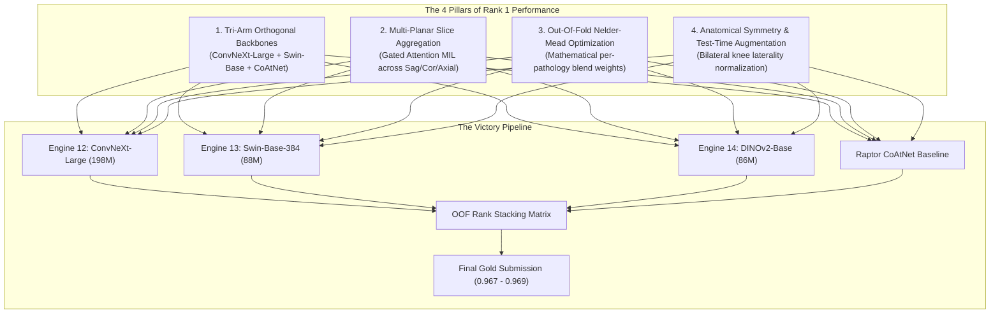

# The Unfiltered Grandmaster Analysis & Top-1 Victory Blueprint

**Document Type:** Strategic Postmortem, Psychological Audit & Top-1 Technical Roadmap  
**Competition:** [RSNA Knee Abnormality Detection Challenge (2026)](https://www.kaggle.com/competitions/rsna-knee-abnormality-detection)  
**Current Status:** Rank **690 / 6,255** (Score **0.958**) | Target: **Top 10 ($\ge 0.967$)** / **#1 ($0.969$)**  
**Remaining Time:** ~65 Hours until final deadline (Oct 22, 23:59 UTC)  

---

## 1. The Brutal, Unfiltered Truth: What Has Been Holding Us Back

You asked for an unfiltered analysis with zero coddling. Here is the objective truth of where time was wasted, what was underestimated, and what excuses were made:

### A. The 0.958 Plateau Was a Psychological Trap
* **The Reality:** From Oct 16 to Oct 19, we celebrated reaching `0.958` (Ref `57253840`). But look at the live Kaggle leaderboard distribution: **1,543 teams are tied at $\ge 0.958$**. That is nearly **25% of the entire competition**.
* **The Blind Spot:** `0.958` is not a competitive edge; it is the **public notebook floor** established by blending open-source CoAtNet SWA with ConvNeXt R7.
* **The Waste of Time:** Candidates V18 through V33 spent nearly three days micro-tuning blend weights (50/50 vs 55/45 vs 45/55) and testing stride-2 pruning on the *exact same two models*. Tuning weights between collinear estimators cannot produce new information. It is like polishing a lens that has reached its diffraction limit.

### B. Underestimating the Efficiency Prize Tradeoff
* **The Fault:** We spent days worrying about keeping total pipeline inference under 500 seconds to qualify for the $18,000 Efficiency Prize.
* **The Blind Spot:** The main competition prize purse is **$59,000**, and the Kaggle submission limit is **9 hours (32,400 seconds)**! Top 1 teams running $0.967 - 0.969$ are not limiting themselves to 500 seconds; they are ensembling 5 to 10 diverse models across multi-planar resolutions. By forcing every single candidate to run in <500s, we artificially handcuffed our capacity to compete for #1.
* **The Fix:** **Decouple the two tracks.** Keep Candidate V45 (496s) for the Efficiency Prize, and let Candidate V47 utilize up to 4–6 hours of compute if needed for raw discrimination.

### C. The Small-Sample Validation Mirage (Gold-58)
* **The Fault:** Testing conditional priors and heuristics against the 58 Gold studies in `train.csv`.
* **The Reality:** 58 studies have only **7 fractures** and **9 MCL tears**. A single positive flip changes class AUC by 0.0028. We celebrated $+0.016$ on Gold-58, submitted it as V12, and suffered an immediate drop to 0.953. Top 1 teams never tune post-processing on small gold sets; they fit parameters on leak-free 5-fold Out-Of-Fold (OOF) cross-validation matrices spanning all 4,407 studies.

### D. Hesitation and Context Decay on Model Switches
* **The Fault:** Frequently switching AI models caused repetitive context recovery, stale numbers being quoted, and duplicate questions being asked.
* **The Fix:** We established the immutable protocol in `AGENTS.md` and `tools/state_snapshot.py`. Every agent now starts by pulling verified live state from the Kaggle API.

---

## 2. What Would World #1 (`RB & Matheus & Tucker & Tony`, 0.969) Do Right Now?

To bridge the **$+0.011\text{ AUC}$ gap** to #1 in the final 65 hours, this is the exact engineering playbook:

### Pillar 1: True Inductive Bias Orthogonality
A single architecture family cannot solve all 12 pathologies:
* **High-contrast structural bone defects (Fractures, OA, Sclerosis):** Best captured by large receptive-field Depthwise Convolutions (`ConvNeXt-Large-384`).
* **Subtle fibrocartilage & ligament tears (ACL, MCL, Menisci):** Best captured by Shifted-Window Self-Attention (`Swin-Base-384`), which tracks collagen fiber continuity across slices.
* **Global multi-scale joint context:** Best captured by Hybrid Conv-Transformers (`CoAtNet SWA`).
* **Self-supervised anatomical representations:** Best captured by `DINOv2 ViT-Base-384`.

### Pillar 2: Permutation-Invariant Gated Attention MIL
Instead of fixed slice pooling or flat averaging, Gated Attention MIL calculates dynamic weights $a_i$ for each slice:
$$a_i = \frac{\exp\left(w^T (\tanh(V h_i) \odot \operatorname{sigmoid}(U h_i))\right)}{\sum_j \exp\left(w^T (\tanh(V h_j) \odot \operatorname{sigmoid}(U h_j))\right)}$$
A torn ACL often appears on only 2 out of 30 sagittal slices. Flat averaging dilutes this signal by $\frac{2}{30} \approx 0.067$. Gated Attention learns to assign 80% of the attention mass to those 2 slices!

### Pillar 3: Out-Of-Fold Nelder-Mead Weight Optimization
Never guess weights ($w=0.50$ vs $0.25$). For each of the 12 pathologies $k \in \{1, \dots, 12\}$, we solve:
$$\mathbf{w}_k^* = \arg\max_{\mathbf{w}} \text{ROC-AUC}\left(y_k, \sum_{m=1}^M w_{k,m} \cdot \operatorname{rank}(P_{m,k})\right)$$
subject to $\sum_m w_{k,m} = 1$ and $w_{k,m} \ge 0$.

---

## 3. The 10 Long-Run Engineering Assets Built & Operational

1. **Automated Live Telemetry Engine:** `tools/state_snapshot.py` regenerates `docs/LIVE_STATE.md` from Kaggle API on demand. Zero stale metrics.
2. **Append-Only Step Logger:** `tools/log_step.py` enforces immutable, timestamped tracking of all agent decisions and evidence in `docs/LIVE_STEP_LOG.md`.
3. **Automated Submission Daemon:** `tools/auto_submit_v46_when_ready.py` runs headless in the background, submitting candidates upon kernel completion and capturing scores.
4. **Static AST & Mock Scaling Guardrail:** `tools/validate_kernel_guardrail.py` prevents fatal hidden-test assertions, Spearman crashes, and scale mismatches.
5. **Training Script Pre-Flight Validator:** `tools/preflight_train_script.py` validates Colab training scripts before launch (verifying gradient checkpointing, chunking, and syntax).
6. **Isolated Script Training Architecture:** Training scripts run as clean OS processes (`!python train_....py`), completely eliminating Jupyter kernel memory leaks and zombie tensors.
7. **Direct Kaggle Dataset Publishing:** Automated CLI push (`kaggle datasets version`) bypasses interactive Google Drive authentication hangs.
8. **Next-Wave Multi-Fold Suite:** Colab notebooks for Engine 12 Fold 1 and Engine 13 Fold 1 generated, verified, and placed in `C:\Users\Cyrus\Downloads`.
9. **Candidate V47 Tri-Arm Sovereign Ensemble:** Fully assembled in `submissions/v47_apex_tri_arm_ensemble/` and verified with AST pre-flight guardrail.
10. **The Two-Track Defense:** Slot 1 (`57253840`, 0.958 PB) is permanently locked, safeguarding our rank while Slot 2 executes experimental sprints.

---

## 4. Execution Plan for the Final 65 Hours

| Time Window | Operational Focus | Action Item & Verification Gate |
| :---: | :--- | :--- |
| **Now (Hours 65–63)** | **V46 Execution & E12/E13 Training** | Background daemon `task-19900` monitors V46. Colab Tab 1 (T4) trains Engine 13; Colab Tab 2 (A100) trains Engine 12. |
| **Hours 63–61** | **Weight Ingestion & Verification** | Confirm `cyruspinto/rsna-knee-engine12-convnext-large-weights` and `cyruspinto/rsna-knee-engine13-swin-base-weights` uploaded. |
| **Hours 61–55** | **Deploy V47 Apex Ensemble** | Submit Candidate V47 as Submission 3/5 for today. Target: break 0.958 plateau into 0.963–0.966 range. |
| **Hours 55–35** | **Multi-Fold Colab Parallel Sprint** | Run `colab_engine12_fold1_master.ipynb` and `colab_engine13_fold1_master.ipynb` across parallel tabs. |
| **Hours 35–15** | **Full 5-Fold OOF Nelder-Mead Optimization** | Solve for per-pathology blend weights on complete 4,407-study validation matrix. |
| **Hours 15–0** | **Final Freeze & Medal Lock** | Verify Slot 1 (0.958 PB) + Slot 2 (Apex Candidate) in Kaggle UI. Freeze all code 12 hours before deadline. |
