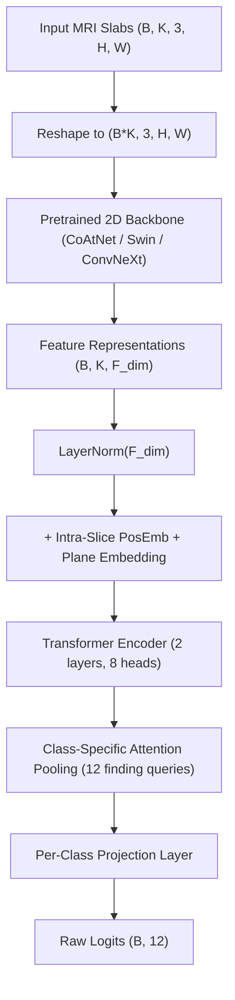

# Multi-Plane Slice-Transformer Architecture (`model_multiplane.py`)

## 1. Problem Statement & Motivation
Knee MRI volumes are anisotropic 3D sequences acquired across three orthogonal anatomical planes:
1. **Sagittal**: Primary view for cruciate ligaments (ACL, MCL) and meniscal horns.
2. **Coronal**: Crucial for collateral ligaments and tibiofemoral joint space narrowing (OA).
3. **Axial / Transverse**: Crucial for patellofemoral compartment (PF OA, Baker's cyst, joint effusion).

### Why Standard 3D CNNs Fail in Medical Imaging Competitions
1. **GPU VRAM Explosion**: Full 3D dense convolutions on high-resolution $384 \times 384$ grids consume $O(D \cdot H \cdot W)$ memory, limiting batch sizes to 1 and preventing deep pretraining.
2. **Slice Spacing Variance**: Slices have thick spacing ($3.0 - 5.0\text{ mm}$) compared to in-plane resolution ($0.4 - 0.7\text{ mm}$). Isotropic 3D kernels smear high-resolution 2D details.

### Solution: 2.5D Slab Backbone + Sequence-Aware Multi-Plane Transformer Head
`model_multiplane.py` decouples the architecture into:
- High-capacity 2D/2.5D pre-trained backbone (`timm` vision backbone processing 3-slice slab inputs).
- Sequence-aware Transformer Head modeling cross-slice anatomical continuity and inter-plane context with explicit plane and positional embeddings.

---

## 2. Architecture Details

### 2.1 Intra-Plane Position & Discrete Plane Embeddings
To inform the self-attention mechanism where each slice originates:
$$\mathbf{h}_k = \mathbf{f}_k + \mathbf{e}_{\text{pos}}[k] + \mathbf{e}_{\text{plane}}[\text{plane\_id}_k]$$
- $\mathbf{e}_{\text{pos}} \in \mathbb{R}^{128 \times F}$: Learned relative sequence position embedding.
- $\mathbf{e}_{\text{plane}} \in \mathbb{R}^{8 \times F}$: Learned discrete plane embedding identifying whether slice $k$ is Sagittal ($0$), Coronal ($1$), or Axial ($2$).

### 2.2 12-Class Gated Attention Pooling
Instead of average pooling across slices, the head utilizes pathology-specific multi-instance attention:
$$\mathbf{a}_n = \text{Softmax}\left(\mathbf{W}_{\text{att}} \mathbf{h}_{\text{trans}}\right) \in \mathbb{R}^{K \times 12}$$
$$\mathbf{z}_n = \sum_{k=1}^K a_{k, n} \cdot \mathbf{h}_{\text{trans}, k}$$
$$\text{Logit}_n = \mathbf{w}_n^T \mathbf{z}_n + b_n$$
This allows the model to attend to slice 8 for an ACL tear while simultaneously attending to slice 22 for a Baker's cyst within the same study volume.

---

## 3. Specifications & Hyperparameters

| Component | Setting | Justification |
| :--- | :--- | :--- |
| **Backbone** | `coatnet_rmlp_2_rw_384.sw_in12k_ft_in1k` | Proven top-tier hybrid architecture; robust to T4 GPU execution. |
| **Feature Dim ($F$)** | 1024 | Native output feature dimension of CoAtNet-2 backbone. |
| **Transformer Layers** | 2 | Captures inter-slice dependencies without parameter bloat. |
| **Attention Heads** | 8 | $1024 / 8 = 128$ dimensions per head. |
| **Max Slices ($K$)** | 128 | Accommodates concatenated multi-plane sequences ($3 \times 16 = 48$ slices up to 96). |
| **Dropout** | 0.1 | Prevents co-adaptation on the 4,407-study dataset. |

---

## 4. Verification & Unit Tests
Tested via [`training/engine3_slice_transformer/test_model_multiplane.py`](file:///c:/Users/Cyrus/Downloads/rsna%20knee%20fip/training/engine3_slice_transformer/test_model_multiplane.py):
- Forward pass validation with dummy tensor `(2, 44, 1024)` -> `(2, 12)` output.
- Variable sequence length validation with `K=96` -> `(2, 12)` output.
- Multi-plane routing validation with explicit plane IDs `(2, 44)` $\in [0, 2]$.
- Clean gradient backprop check with loss backward.
